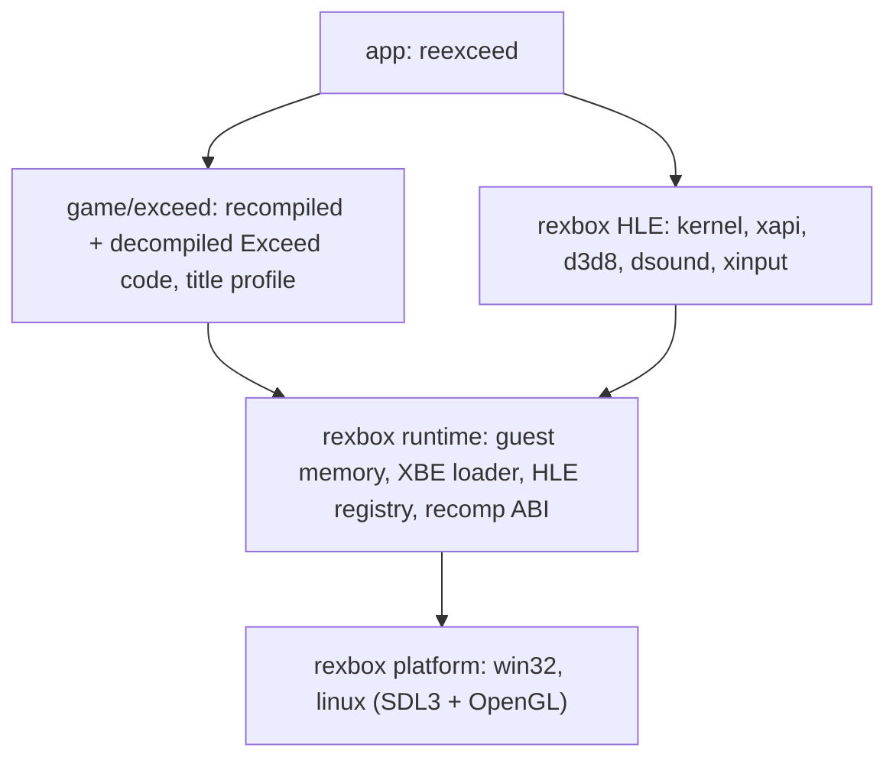

# reEXCEED

Xbox 게임 **Pump It Up: Exceed**(Andamiro, 2005, 북미판)를 정적 재컴파일과 디컴파일로 Win32, Win64, Linux x86, Linux x64, Web, Android에 네이티브 포팅하는 프로젝트입니다. Xbox 커널·XDK·하드웨어를 대신하는 런타임은 [reJSRF](https://github.com/nworkers/reJSRF), [reCT3](https://github.com/reexec/reCT3)와 공유하는 [rexbox](https://github.com/reexec/rexbox)입니다.

> **준비 단계입니다.** 규칙, 레이어, 공유 런타임, 앱, 빌드와 CI가 갖춰졌고 북미판 `default.xbe`(title id `41440002`, XDK 5849)의 신원이 등록되었습니다. 앱은 이 XBE를 식별하고 게스트 메모리에 배치한 뒤 멈춥니다. 다음 단계는 재컴파일 코드 생성과 첫 부팅입니다.

## 게임 데이터는 포함되지 않습니다

이 저장소에는 게임의 실행 파일, 자산, 그리고 실행 파일에서 기계적으로 생성한 코드가 들어 있지 않으며 앞으로도 넣지 않습니다. 직접 소유한 디스크의 덤프를 `roms/`에 두고 사용하세요.

## 구조



* **rexbox**(`third_party/rexbox`, submodule, v0.0.26)는 타이틀에 의존하지 않는 재사용 가능한 Xbox 런타임입니다. reJSRF에서 만들어져 분리되었고, reJSRF·reCT3·reEXCEED가 공유합니다.
* **game/exceed**는 원본 x86 코드를 C로 옮긴 재컴파일 코드(로컬 생성)와, 그것을 함수 단위로 대체하는 디컴파일 코드, 타이틀 프로파일을 담습니다.
* **xboxrecomp**(`third_party/xboxrecomp`, submodule)는 upstream 최신 릴리스 v0.16.0입니다. 재컴파일 파이프라인과 lifter ABI 헤더가 여기서 옵니다.
* 자세한 내용: [ARCHITECTURE.md](ARCHITECTURE.md), [설계 i001](docs/design/20261103-i001-project-bootstrap.md), [프로젝트 헌장](docs/PROJECT_CHARTER.md), [XBE 분석](docs/analysis/exceed-xbe-overview.md)

## 빌드 (Win32)

```powershell
git clone --recurse-submodules https://github.com/reexec/reEXCEED.git
cd reEXCEED
.\scripts\build_win32_x86.ps1          # 실행 정책이 막으면 scripts\build_win32_x86.bat
.\build\win32_x86\src\app\Debug\reexceed.exe roms
```

인자는 디스크에서 추출한 **게임 디렉터리**입니다. 앱은 그 폴더를 게임의 `D:`로 쓰고 `default.xbe`(디스크의 `DEFAULT.XBE`처럼 대소문자가 달라도 됨)를 읽어 인증서로 식별합니다(`--xbe <파일>`로 다른 XBE). 등록된 북미판이면 실행하고, 아니면 멈춥니다.

자세한 절차: [Win32 개발 환경 준비와 빌드](docs/guides/win32-setup-and-build.md)

## 빌드 (Linux)

```bash
git clone --recurse-submodules https://github.com/reexec/reEXCEED.git
cd reEXCEED
# roms/ 에 게임 파일을 두고, 처음 한 번 재컴파일 코드를 만든다(python3-capstone 필요)
cmake --preset linux-x64-release && cmake --build --preset linux-x64-release --target rexbox_xdk_symbols
python3 scripts/recomp/regenerate.py
scripts/build_linux.sh x64 release     # configure + build + ctest (x86: scripts/build_linux.sh x86 release)
build/linux-x64-release/src/app/reexceed roms
```

자세한 절차(필요한 패키지, x86, WSL2): [Linux 개발 환경 준비, 빌드, 실행](docs/guides/linux-setup-and-build.md)

## 플랫폼 상태

| 플랫폼 | 상태 |
|---|---|
| Win32 x86 | Debug·Release 빌드(재컴파일 코드 없이), CTest 6/6. 북미판 XBE 식별과 로드 단계까지 |
| Win64 | 예정 |
| Linux x64 | 빌드, CTest 7/7, 실기(Ubuntu 26.04, GCC 15)의 Wayland에서 타이틀·어트랙트까지. X11은 [알려진 제한](docs/guides/linux-setup-and-build.md#8-알려진-제한-issue-16). CI에서도 빌드 |
| Linux x86 | 빌드, CTest 7/7, 게임 로직은 어트랙트까지. NVIDIA Wayland에서 화면 없음, X11 크래시([알려진 제한](docs/guides/linux-setup-and-build.md#8-알려진-제한-issue-16)) |
| Web (wasm32) | 예정 |
| Android | 예정 |

## 기여와 작업 규칙

[AGENTS.md](AGENTS.md)와 [docs/CODING_STYLE.md](docs/CODING_STYLE.md)를 따릅니다. 규칙은 reCT3, reJSRF와 같고, 그 바탕은 [reexec/rePIU](https://github.com/reexec/rePIU)입니다.

## 참고 프로젝트

[rexbox](https://github.com/reexec/rexbox), [reCT3](https://github.com/reexec/reCT3), [reJSRF](https://github.com/nworkers/reJSRF), [xboxrecomp](https://github.com/sp00nznet/xboxrecomp) 등. 목록과 라이선스: [rexbox의 docs/kb/external-references.md](third_party/rexbox/docs/kb/external-references.md), [CREDITS.md](CREDITS.md)

## 라이선스

[MIT](LICENSE). 서드파티 코드: [THIRD_PARTY_NOTICES.md](THIRD_PARTY_NOTICES.md). Pump It Up은 Andamiro의 상표이며, 이 프로젝트는 Andamiro 또는 Microsoft와 관련이 없습니다.

---

# reEXCEED

A native port of the Xbox game **Pump It Up: Exceed** (Andamiro, 2005, the North America build) to Win32, Win64, Linux x86, Linux x64, the web and Android through static recompilation and decompilation. The runtime that stands in for the Xbox kernel, the XDK and the hardware is [rexbox](https://github.com/reexec/rexbox), shared with [reJSRF](https://github.com/nworkers/reJSRF) and [reCT3](https://github.com/reexec/reCT3).

> **Preparation stage.** The rules, layers, shared runtime, app, build and CI are in place, and the identity of the North America `default.xbe` (title id `41440002`, XDK 5849) is registered. The app identifies that XBE, places it in guest memory and stops. Generating the recompiled code and the first boot come next.

## No game data included

This repository does not and will not contain the game's executable, its assets, or code mechanically generated from the executable. Put a dump of a disc you own under `roms/`.

## Structure

See the diagram above. **rexbox** (`third_party/rexbox`, a submodule, v0.0.26) is the reusable, title-agnostic Xbox runtime, built in reJSRF and split out for reJSRF, reCT3 and reEXCEED; **game/exceed** holds the recompiled code (the original x86 lifted to C, generated locally), the decompiled code that replaces it function by function, and the title profile; **xboxrecomp** (`third_party/xboxrecomp`, a submodule) is upstream's latest release, v0.16.0, the source of the recompilation pipeline and the lifter ABI header. More: [ARCHITECTURE.md](ARCHITECTURE.md), [design i001](docs/design/20261103-i001-project-bootstrap.md), [project charter](docs/PROJECT_CHARTER.md), [XBE analysis](docs/analysis/exceed-xbe-overview.md).

## Build (Win32)

See the commands above, and [Win32 development setup and build](docs/guides/win32-setup-and-build.md) for the full procedure. The argument is the **game directory** extracted from the disc; the app serves it as the game's `D:`, loads `default.xbe` (in any case, such as the disc's `DEFAULT.XBE`) or the file `--xbe` names, and identifies it by its certificate: the registered North America build runs, anything else stops.

## Build (Linux)

See the commands above: with the game files under `roms/`, build `rexbox_xdk_symbols`, generate the recompiled code once with `regenerate.py` (`python3-capstone` needed), then `scripts/build_linux.sh x64 release` (or `x86`) configures, builds and runs CTest, and `build/linux-x64-release/src/app/reexceed roms` starts the game. The packages, the x86 build and WSL2 are in [Linux development setup, build and run](docs/guides/linux-setup-and-build.md).

## Platform status

Win32 x86 builds in Debug and Release (without recompiled code), CTest passes 6/6, and the app identifies the North America XBE and runs through the load stage; Linux x64 builds, passes CTest 7/7, and runs through the title and attract demo on a Linux machine (Ubuntu 26.04, GCC 15) under Wayland, with X11 being a [known limitation](docs/guides/linux-setup-and-build.md#8-known-limitations-issue-16), and also builds in CI; Linux x86 builds, passes CTest 7/7, and runs game logic through the attract demo, with no display under NVIDIA Wayland and an X11 crash ([known limitations](docs/guides/linux-setup-and-build.md#8-known-limitations-issue-16)); Win64, the web (wasm32) and Android are planned.

## Contributing and working rules

Follow [AGENTS.md](AGENTS.md) and [docs/CODING_STYLE.md](docs/CODING_STYLE.md). The rules are those of reCT3 and reJSRF, based on [reexec/rePIU](https://github.com/reexec/rePIU).

## License

[MIT](LICENSE). Third-party code: [THIRD_PARTY_NOTICES.md](THIRD_PARTY_NOTICES.md). Pump It Up is a trademark of Andamiro; this project is not affiliated with Andamiro or Microsoft.
