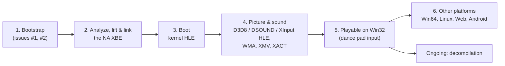

# 프로젝트 헌장

## 목적

reEXCEED는 Xbox 게임 Pump It Up: Exceed(Andamiro, 2005)를 정적 재컴파일과 디컴파일로 Win32, Win64, Linux x86, Linux x64, Web, Android에서 네이티브로 실행되게 만든다.

게임 로직은 원본 x86 코드에서 기계적으로 옮긴 코드가 담당하고, 디컴파일은 그 코드를 같은 동작의 읽을 수 있는 코드로 바꿔 간다. Xbox 커널, XDK 라이브러리, 하드웨어를 대신하는 HLE와 호스트 플랫폼 서비스는 reJSRF, reCT3와 공유하는 런타임 [rexbox](https://github.com/reexec/rexbox)가 맡고, 이 저장소는 타이틀 계층과 앱에 집중한다.

## Purpose

reEXCEED makes the Xbox game Pump It Up: Exceed (Andamiro, 2005) run natively on Win32, Win64, Linux x86, Linux x64, the web and Android through static recompilation and decompilation.

Game logic is carried by code mechanically lifted from the original x86, and decompilation gradually turns that code into readable code of the same behavior. The HLE that stands in for the Xbox kernel, the XDK libraries and the hardware, and the host platform services, are the shared runtime [rexbox](https://github.com/reexec/rexbox), which reJSRF and reCT3 use too; this repository focuses on the title layer and the app.

## 현재 1차 목표

* 1차 타깃 실행 파일은 북미판 `default.xbe`(region 1, title id `41440002`, XDK 5849)다. 사용자의 덤프가 `roms/`에 있고, `scripts/recomp/register_xbe.py`로 신원(MD5, 인증서)을 등록했다(issue #1). 다른 지역판(한국판 등)은 발견되면 식별만 한다.
* 1차 호스트는 Win32 x86이다. 어느 정도 진행된 뒤 Win64, Linux x86/x64, Web, Android로 넓힌다.
* lifter는 upstream xboxrecomp의 최신 릴리스 v0.16.0이며, 이 저장소가 고정하고 실행한다(rexbox는 lifter를 모른다, rexbox issue #26). fork에만 있는 lifter 수정이 필요해지면 upstream PR로 해결한다.
* Exceed는 reJSRF·reCT3보다 새 XDK(5849)이고, 곡 음악(WMA, `WMADEC`), 배경 동영상(XMV), XACT 사운드 뱅크, Xbox Live 라이브러리를 정적 링크한다. 이들은 lift된 CPU 코드로 돌리고, 하드웨어에 닿는 경계(D3D8, DSOUND, 커널)만 HLE로 둔다. 그에 맞춰 rexbox의 HLE를 넓히는 일은 rexbox 저장소에서 한다.

## Current First Target

* The first target executable is the North America `default.xbe` (region 1, title id `41440002`, XDK 5849). The user's dump is under `roms/`, and its identity (MD5, certificate) is registered with `scripts/recomp/register_xbe.py` (issue #1). Other regional builds (Korean and so on) are recognized only, when found.
* The first host is Win32 x86. Once the project is well along, it widens to Win64, Linux x86/x64, the web and Android.
* The lifter is upstream xboxrecomp's latest release, v0.16.0, pinned and run by this repository (rexbox knows no lifter, rexbox issue #26). Lifter fixes that exist only in a fork are taken through upstream pull requests when needed.
* Exceed is on a newer XDK (5849) than reJSRF and reCT3, and statically links song music (WMA, `WMADEC`), background movies (XMV), XACT sound banks and the Xbox Live libraries. These run as lifted CPU code; only the boundaries that reach the hardware (D3D8, DSOUND, the kernel) are HLE. Widening rexbox's HLE for them is done in the rexbox repository.

## 방향성

* 재컴파일된 원본 코드를 기준 구현으로 취급한다.
* 에뮬레이터(xemu, Cxbx-Reloaded)를 통합하지 않는다. 동작 비교의 기준으로만 쓴다.
* 재사용 가능한 Xbox 런타임 `rexbox`와 타이틀 코드 `reexceed`를 분리한다. rexbox에 필요한 변경은 rexbox 저장소에서 한다.
* HLE는 API 경계(커널 ordinal, XDK 라이브러리 함수)에서 하고, 하드웨어 LLE는 필요한 지점에만 둔다.
* 게임 데이터와 그것에서 생성한 코드는 저장소에 넣지 않는다. 사용자가 자기 덤프로 만든다.
* 라이선스는 MIT이며, 전염성 라이선스 코드는 빌드에 넣지 않는다.
* 코드 변경 전에는 설계와 작업 계획을 문서화한다.
* 프로젝트 버전은 `VERSION` 파일의 `major.minor.patch` 형식으로 관리한다.

## Direction

* Treat the recompiled original code as the reference implementation.
* Do not integrate an emulator (xemu, Cxbx-Reloaded); use one only as a reference for comparing behavior.
* Keep the reusable Xbox runtime `rexbox` separate from the title code `reexceed`; changes rexbox needs are made in its repository.
* Do HLE at API boundaries (kernel ordinals, XDK library functions), with hardware LLE only where needed.
* Keep game data and code generated from it out of the repository; users build it from their own dump.
* The license is MIT, and copyleft code is not built in.
* Document design and work plans before changing code.
* Manage the project version in the `VERSION` file using `major.minor.patch`.

## 단계

1. 부트스트랩: 규칙, 레이어, 공유 rexbox submodule, 앱, 빌드와 CI, 북미판 신원 등록(재컴파일 코드 없이).
2. 북미판 XBE 분석과 재컴파일 파이프라인 연결: XBE를 lift해 Win32에서 링크한다.
3. 커널 HLE로 진입점부터 부팅한다.
4. D3D8, DSOUND, XInput HLE로 화면과 소리를 낸다. XDK 5849에 맞춰 rexbox의 HLE를 넓히고, 곡 음악(WMA)과 배경 동영상(XMV)이 lift된 코드로 재생되는지 확인한다.
5. Win32에서 플레이 가능(댄스 패드 입력 포함).
6. Win64, Linux, Web, Android로 확장한다. 디컴파일은 2단계 이후 계속 진행한다.

## Stages

1. Bootstrap: rules, layers, the shared rexbox submodule, the app, build and CI, and the North America build's identity registered (without recompiled code).
2. Analyze the North America XBE and connect the recompilation pipeline: lift the XBE and link it on Win32.
3. Boot from the entry point on kernel HLE.
4. Picture and sound through D3D8, DSOUND and XInput HLE, widening rexbox's HLE for XDK 5849, and checking that song music (WMA) and background movies (XMV) play through the lifted code.
5. Playable on Win32 (dance pad input included).
6. Widen to Win64, Linux, the web and Android. Decompilation proceeds continuously from stage 2 on.
