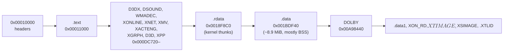

# Exceed XBE 구조와 설계 (한국어)

원본 XBE 분석으로 확인한 구조를 누적한다. 상세 근거와 확인 상태는 [`docs/analysis/`](analysis/README.md)에 있고, 여기에는 설계에 영향을 주는 결론만 모은다. 영어판: [XBE_DESIGN.en.md](XBE_DESIGN.en.md).

## 1. 대상 빌드

* 1차 타깃은 북미판 `default.xbe`(지역 1, title id `41440002`, MD5 `575f861e…`, XDK 5849)다. → [exceed-xbe-overview §1](analysis/exceed-xbe-overview.md)
* 디스크의 다른 XBE 셋(`UPDATE`, `DOWNLOADER`, `DASHUPDATE`)은 Xbox Live·대시보드 도구라 대상이 아니다.
* 다른 지역판이 발견되면 식별만 하고, 주소는 공유하지 않는 것으로 본다(**추정**).

## 2. 메모리 배치

* 이미지 끝은 base + `0xA94D20`이다. 64 MiB 게스트 RAM 안에 들어간다.
* kernel thunk 표는 `.rdata`의 첫 주소 `0x0018F8C0`에 있다. 146개 슬롯.
* 물리 주소 창: 타이틀이 `| 0x80000000`을 쓰는지는 아직 모른다. 앱은 reCT3처럼 rexbox의 물리 메모리 창을 켠다(`GuestMemory::Options::physical_window`, rexbox 설계 i008).

## 3. HLE 설계에 주는 결론

* XDK 5849다. rexbox의 D3D8·DSOUND HLE가 5849 배치를 받아야 하는지 lift 뒤 확인한다(**추정**).
* WMA(`WMADEC`), XMV, XACT(`XACTENG`)는 lift된 CPU 코드로 돌린다. 하드웨어 경계는 DSOUND(소리), D3D8(동영상 프레임), 커널(파일)이다.
* 커널 import 146개 중 42개가 HLE에 없다(목록은 analysis §4). 대부분 I/O 관리자, 암호, 네트워크다. 부팅이 닿으면 그때 rexbox에 구현한다.

## 4. 시작 순서와 커널 구조

* 진입점은 `0x0008673A`이다. 시작 순서는 lift와 첫 실행에서 확인한다(**미확정**).

## 5. 세이브 데이터와 해금 구조

* 세이브 버퍼(`[0x0084865C]`, `0x5028`바이트)는 앞 `0x2800`바이트에 활성 프로필, 뒤 `0x2800`바이트에 더티 판정용 사본을 둔다. 디스크 저장(`sub_00072F10`)은 두 영역이 다를 때만 실행된다. → [exceed-xbe-overview §14](analysis/exceed-xbe-overview.md)
* 곡·채보 잠금은 `.data`의 `0x001C5D48`(항목 `0x50`바이트, `+0x40..+0x47`)에서 읽히며, 선곡 진입 시 `sub_000278A0`이 세이브 버퍼(`+0x1373`, `+0x1773`)에서 동기화하고 이탈 시 `sub_00033340`(vtable[3])이 정리한다.
* 배속·노트 옵션 해금은 세이브 버퍼 `+0x1F73..+0x1F7D`(카테고리 11개)와 `+0x1F89..+0x1FBD`(세부 항목)에 있고, 서브 모드 11개(`0..10`)는 `sub_00038D60`이 `sub_00038CE0`으로 판정해 모드 메뉴(`+0x58`, `+0x5C`)를 채운다.
* 내장 오토플레이는 `"PLAY"` 씬 객체(`[0x00825114]`, `play_ptr`)의 `MEM8(play_ptr + 0x39D)` 플래그로 제어되며, `sub_00017530`이 매 프레임 이를 확인해 내장 오토플레이 봇 `sub_0001E630`을 호출한다.

---

(영어 번역은 [XBE_DESIGN.en.md](XBE_DESIGN.en.md)에 있다.)
