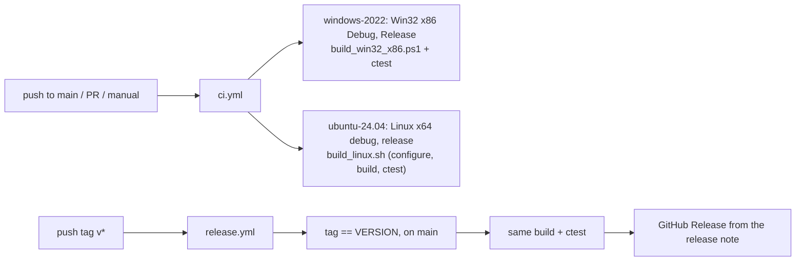

# 설계: GitHub Actions — main 검증, 태그 검증, 릴리스 (issue #2)

상태: **구현됨**(실행은 push 뒤). 작업 지시: [20261103-i002](../work-orders/20261103-i002-github-actions.md) · 작업 로그: [20261103-i002](../work-logs/20261103-i002-github-actions.md)

규칙은 [rexbox 설계 i002](https://github.com/reexec/rexbox/blob/main/docs/design/20261020-i002-github-actions.md)와 [reCT3 설계 i002](https://github.com/reexec/reCT3/blob/main/docs/design/20261020-i002-github-actions.md)와 같다. 워크플로 파일은 reCT3의 것을 이름만 바꿔 쓴다. 여기에는 reEXCEED에서 정한 것만 적는다.

## 1. 요구사항

* `main` 반영과 PR마다 빌드와 테스트를 검증한다. `v*` 태그는 `VERSION`과 같고 `main` 위에 있는지 확인하고, 릴리스 노트(`docs/release-notes/v<version>.md`)가 있으면 그것으로 GitHub Release를 만든다. 산출물은 소스만이다.

## 2. 구성

| 항목 | 결정 |
|---|---|
| 테스트 | rexbox submodule이 등록하는 probe 4개(recomp, kernel, dsound, d3d8)와 앱 smoke 2개(`reexceed LICENSE` → `is not a directory`, `reexceed docs` → `has no default.xbe`) |
| 체크아웃 | `submodules: recursive`(rexbox 안의 SDL·imgui·smaa·XbSymbolDatabase와 xboxrecomp) |
| Linux x86 | CI에 넣지 않는다. reCT3·rexbox와 같이 ubuntu-24.04 이미지의 i386 개발 패키지 설치 문제로 로컬에서 확인한다([Linux 가이드](../guides/linux-setup-and-build.md)). issue #2 본문의 "Linux x64/x86"은 이 결정으로 x64만이다 |
| 게임 데이터 | CI에는 없으므로 재컴파일 코드 없는 구성만 검증한다. XBE가 필요한 검증은 로컬 가이드 |
| 릴리스 | 제목 `reEXCEED <tag>`. 소스 아카이브에는 submodule이 없으므로 `--recurse-submodules` clone을 안내한다 |

## 3. 검증

* 로컬 `ctest -C Debug`, `-C Release`: 6개 테스트 통과.
* Actions는 push 뒤 PR에서 돈다. 태그 경로는 첫 태그 push 때 확인한다.

---

# Design: GitHub Actions — main verification, tag verification, releases (issue #2)

Status: **implemented** (runs after the push). Work order: [20261103-i002](../work-orders/20261103-i002-github-actions.md) · Work log: [20261103-i002](../work-logs/20261103-i002-github-actions.md)

The rules are those of [rexbox design i002](https://github.com/reexec/rexbox/blob/main/docs/design/20261020-i002-github-actions.md) and [reCT3 design i002](https://github.com/reexec/reCT3/blob/main/docs/design/20261020-i002-github-actions.md); the workflow files are reCT3's under the new name. Only reEXCEED's decisions are recorded here.

## 1. Requirements

Every push to `main` and every pull request builds and tests the project. A `v*` tag must equal `VERSION` and sit on `main`; when `docs/release-notes/v<version>.md` exists, a GitHub Release is created with it as the body. Source only.

## 2. Setup

The diagram and table above apply. Tests: the four probes the rexbox submodule registers (recomp, kernel, dsound, d3d8) and the two app smoke tests (`reexceed LICENSE` must say `is not a directory`, `reexceed docs` must say `has no default.xbe`). Checkout: `submodules: recursive`. Linux x86 is not in CI: as in reCT3 and rexbox, the i386 development packages do not install on the ubuntu-24.04 image, so x86 is checked locally; the "Linux x64/x86" of issue #2's text becomes x64 only by this decision. CI has no game data, so only the no-recompiled-code configuration is verified. Releases are titled `reEXCEED <tag>` and point at a `--recurse-submodules` clone, since the source archives hold no submodules.

## 3. Verification

Local `ctest -C Debug` and `-C Release` pass the six tests; the Actions run on the pull request after the push, and the tag path with the first tag.
