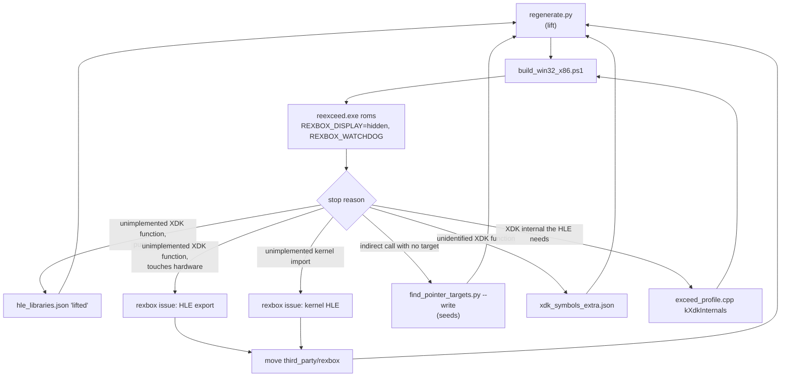

# 설계: 북미판 lift와 첫 부팅 (issue #4)

상태: **완료**(타이틀 화면까지, 남은 것은 작업 로그의 후속 항목). 작업 지시: [20261103-i004](../work-orders/20261103-i004-first-run.md) · 작업 로그: [20261103-i004](../work-logs/20261103-i004-first-run.md)

선행: [설계 i001](20261103-i001-project-bootstrap.md)(등록, HLE 대상의 첫 선택), [분석](../analysis/exceed-xbe-overview.md). 방식은 reCT3의 첫 실행([reCT3 작업 로그 i003](https://github.com/reexec/reCT3/blob/main/docs/work-logs/20261020-i003-first-run.md))과 같다.

## 1. 요구사항

* 북미판 `default.xbe`를 upstream xboxrecomp v0.16.0으로 lift하고 Win32 x86에서 링크한다.
* 진입점부터 실행해 멈추는 지점(frontier)을 하나씩 넘긴다. 목표는 첫 화면이 present되는 것이고, 그 너머는 같은 issue의 후속 세션에서 이어 간다.

## 2. 절차

* 이 저장소에서 바꾸는 것은 재컴파일 설정(`recomp/*.json`), 프로파일, 앱뿐이다. 런타임(HLE, 커널)이 바뀌어야 하면 rexbox에 issue를 열고 rexbox의 규칙으로 진행한 뒤 submodule을 그 커밋으로 올린다(AGENTS.md). 작업 브랜치 커밋 고정은 임시이며 릴리스 노트에 적는다.
* 진단은 rexbox의 환경 변수를 쓴다: `REXBOX_DISPLAY=hidden`(창 없이 그리기), `REXBOX_AUDIO=none`, `REXBOX_WATCHDOG=<초>`, `REXBOX_HLE_FALLBACK=lifted`(HLE 없는 함수를 lift 본문으로), `REXBOX_HLE_TRACE`, `RECOMP_STUB_LOG`(Debug 기본).

## 3. 위험과 예상

* **XDK 5849**: rexbox의 D3D8 HLE(렌더 상태 번호, 기본 상태 루틴, Caps)와 DSOUND HLE는 4134·4531 배치다. 5849의 배치는 식별된 `D3DRS_*` 변수로 확인한다(**추정**: 다를 수 있다).
* **커널 import 42개 없음**: 시작 경로에서 닿는 것만 구현한다. Xbox Live의 `Xc*`, `Phy*`는 닿지 않을 것으로 본다(**추정**).
* **미들웨어**: WMA, XMV, XACT는 lift된 코드로 돈다. 그 안의 SSE·x87 명령이 lifter에서 미구현이면 frontier가 된다.
* **Xbox Live 초기화**: `XOnlineStartup` 등이 네트워크 커널 import로 닿으면, Live 없는 오프라인 응답(실패 코드)이 원본 동작에 가까운지 확인한다.

## 4. 검증

| 검증 | 기대 |
|---|---|
| `regenerate.py` | 성공, 함수 수·미해결 스텁·미구현 명령 수 기록 |
| Win32 x86 Debug 빌드(생성 코드 포함) | 오류 0 |
| CTest | 기존 6개와 `reexceed_decomp_check`(경우 0) 통과 |
| `reexceed.exe roms` | frontier마다 멈춤 이유와 넘긴 방법을 작업 로그에 남김 |

---

# Design: lifting the North America build and the first boot (issue #4)

Status: **done** (up to the title screen; what remains is listed in the work log's follow-ups). Work order: [20261103-i004](../work-orders/20261103-i004-first-run.md) · Work log: [20261103-i004](../work-logs/20261103-i004-first-run.md)

Before: [design i001](20261103-i001-project-bootstrap.md) (registration, the first choice of HLE targets), [analysis](../analysis/exceed-xbe-overview.md). The approach is reCT3's first run ([reCT3 work log i003](https://github.com/reexec/reCT3/blob/main/docs/work-logs/20261020-i003-first-run.md)).

## 1. Requirements

Lift the North America `default.xbe` with upstream xboxrecomp v0.16.0 and link it on Win32 x86; run it from the entry point and pass the stops (frontiers) one at a time. The goal is a first presented frame; what lies beyond continues in later sessions of the same issue.

## 2. Procedure

The diagram above applies. This repository changes only the recompilation configuration (`recomp/*.json`), the profile and the app. Where the runtime (HLE, kernel) must change, a rexbox issue is opened and worked under rexbox's rules, and the submodule then moves to that commit (AGENTS.md); a pin on a task-branch commit is temporary and noted in the release notes. Diagnostics use rexbox's variables: `REXBOX_DISPLAY=hidden`, `REXBOX_AUDIO=none`, `REXBOX_WATCHDOG=<seconds>`, `REXBOX_HLE_FALLBACK=lifted`, `REXBOX_HLE_TRACE`, and `RECOMP_STUB_LOG` (on in Debug).

## 3. Risks

* **XDK 5849**: rexbox's D3D8 HLE (render-state numbering, the default-state routine, caps) and DSOUND HLE have the 4134 and 4531 layouts; 5849's is checked with the identified `D3DRS_*` variables (**inferred**: it may differ).
* **42 kernel imports missing**: only those the start path reaches are implemented; Xbox Live's `Xc*` and `Phy*` are expected not to be reached (**inferred**).
* **Middleware**: WMA, XMV and XACT run lifted; SSE or x87 instructions in them that the lifter leaves unimplemented become frontiers.
* **Xbox Live start-up**: if `XOnlineStartup` and the like reach network kernel imports, check that an offline answer (a failure code) stays close to the original behavior.

## 4. Verification

As in the table above: `regenerate.py` succeeds and the function, unresolved-stub and unimplemented-instruction counts are recorded; the Win32 x86 Debug build with the generated code has no errors; CTest passes the six existing tests and `reexceed_decomp_check` (no cases); each frontier of `reexceed.exe roms` is recorded in the work log with its stop reason and how it was passed.
