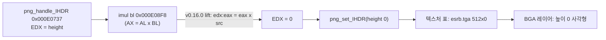

# 설계: 8·16비트 단일 피연산자 곱셈의 lift 우회 — ESRB 공지와 회사 로고 (issue #6)

상태: **구현됨**. 작업 지시: [20261104-i006](../work-orders/20261104-i006-narrow-products.md) · 작업 로그: [20261104-i006](../work-logs/20261104-i006-narrow-products.md)

## 1. 요구사항

부팅 때 ESRB 공지(`BGA\ESRB.DAT`)와 회사 로고(`81.DAT`, `ML.DAT`)가 보이지 않는다. 프레임 60~1020에는 검은 테두리만 그려지고, 그다음 FREEVOLT·INTRO 동영상은 정상이다.

## 2. 원인 (확인됨)

* 타이틀은 libpng 1.2.5(`D3DX` 섹션, 문자열 `1.2.5`)로 BGA 이미지를 읽는다. `png_handle_IHDR`는 높이를 EDX에 둔 채 `imul bl`(채널 수 × 비트 깊이)을 실행한다. 8비트 단일 피연산자 `imul`은 AX만 쓴다.
* upstream xboxrecomp v0.16.0의 `Lifter._lift_imul`/`_lift_muldiv`는 단일 피연산자 `imul`/`mul`을 피연산자 크기와 상관없이 32비트 곱 `edx:eax = eax × src`로 옮긴다. 그래서 EDX가 0이 되고 모든 PNG의 높이가 0이 된다.
* 추적 경로: 프레임 캡처(높이 0인 텍스처 사각형) → RAM 덤프의 BGA 레이어와 키프레임(정상) → 이미지 항목의 사각형 (0,0)-(512,0) → 텍스처 표(`[0x1D1B44]`, `esrb.tga` 512×0) → `REXBOX_WATCH32`로 쓰는 시점 → libpng 경로(`sub_00022840`) → `png_handle_IHDR`. RAM의 PNG IHDR는 512×64다.
* 이 타이틀의 실제 코드에 있는 8비트 단일 피연산자 곱: libpng `0x000E08F8 imul bl`, `0x000E2D32 imul cl`, `0x000E5F67 mul cl`, DSOUND `0x000F1F31 imul bl`.

## 3. 설계

* 같은 수정이 upstream PR [sp00nznet/xboxrecomp#277](https://github.com/sp00nznet/xboxrecomp/pull/277)(OPEN)에 있다. 중복 PR은 내지 않고, 이 타이틀의 사례를 그 PR에 근거로 남긴다.
* upstream 릴리스가 나올 때까지 `scripts/recomp/lifter_patches.py`가 lift 단계(`tools.recomp`)를 실행하면서 `Lifter`의 두 메서드를 이 프로세스 안에서만 바꾼다. 체크아웃은 고치지 않는다(`lifter.py`가 깨끗한지 확인한다).
  * `imul`/`mul r/m8`: AX = AL × src(부호 있음/없음). EAX의 위 16비트와 EDX는 그대로 둔다.
  * `imul`/`mul r/m16`: DX:AX = AX × src. EAX와 EDX의 위 16비트는 그대로 둔다.
  * 32비트 형식, 2·3 피연산자 `imul`, `div`/`idiv`는 upstream 출력 그대로다. #277의 다른 변경(곱셈 뒤 CF/OF 읽기, 시프트 개수 마스크, fnsave)은 가져오지 않는다.
* 제거 조건: #277이 들어간 upstream 릴리스로 고정 버전을 올리면 `lifter_patches.py`와 `run_step(..., patched=True)`를 지운다.

## 4. 검증

* `scripts/recomp/test_lifter_patches.py`: (1) 바꾸지 않는 형식 11개가 upstream과 같은 글자인지, (2) 8·16비트 형식 7개를 컴파일해 5,110개 벡터가 x86 규칙과 같은지 확인한다(패치가 없으면 실패한다).
* upstream 테스트(`pytest tools/`)를 패치 없이와 패치를 적용하고 각각 실행해 결과가 같은지 본다.
* 다시 lift하고 빌드한 뒤 ESRB 공지와 로고가 그려지는지 본다.

---

# Design: working around the lift of 8- and 16-bit one-operand products — the ESRB notice and the company logos (issue #6)

Status: **implemented**. Work order: [20261104-i006](../work-orders/20261104-i006-narrow-products.md) · Work log: [20261104-i006](../work-logs/20261104-i006-narrow-products.md)

**Requirement.** The ESRB notice (`BGA\ESRB.DAT`) and the company logos (`81.DAT`, `ML.DAT`) never show at boot: frames 60–1020 draw only the black borders; the FREEVOLT and INTRO movies after them play correctly.

**Cause (confirmed), as in the diagram above.** The title reads its BGA images through libpng 1.2.5 (the `D3DX` section, string `1.2.5`). `png_handle_IHDR` keeps the height in EDX across `imul bl` (channels times bit depth); an 8-bit one-operand `imul` writes AX only. Upstream xboxrecomp v0.16.0's `Lifter._lift_imul`/`_lift_muldiv` lift every one-operand `imul`/`mul` as the 32-bit product `edx:eax = eax x src` whatever the operand size, so EDX becomes 0 and every PNG gets height 0. Traced from the frame capture (a zero-height textured quad) through the RAM dump's BGA layer and keyframes (sane), the image entry's rectangle (0,0)-(512,0), the texture table (`[0x1D1B44]`, `esrb.tga` 512x0), the moment `REXBOX_WATCH32` saw it written, the libpng path (`sub_00022840`) to `png_handle_IHDR`; the PNG's IHDR in RAM says 512x64. The title's real code has four 8-bit one-operand products: libpng's `0x000E08F8 imul bl`, `0x000E2D32 imul cl` and `0x000E5F67 mul cl`, and DSOUND's `0x000F1F31 imul bl`.

**Design.** The same fix is in the open upstream PR [sp00nznet/xboxrecomp#277](https://github.com/sp00nznet/xboxrecomp/pull/277); no duplicate PR is opened, and this title's case is left on that PR as evidence. Until an upstream release carries it, `scripts/recomp/lifter_patches.py` runs the lift step (`tools.recomp`) and replaces two `Lifter` methods in that process only; the checkout is not modified (`lifter.py` checks it is clean). `imul`/`mul r/m8` give AX = AL x src (signed or unsigned) and leave the upper 16 bits of EAX and all of EDX; `imul`/`mul r/m16` give DX:AX = AX x src and leave the upper halves of EAX and EDX. The 32-bit forms, two- and three-operand `imul`, and `div`/`idiv` stay exactly as upstream emits them; #277's other changes (reading CF/OF after a product, shift-count masking, fnsave) are not taken. Removal: when the pin moves to an upstream release with #277, `lifter_patches.py` and `run_step(..., patched=True)` go.

**Verification.** `scripts/recomp/test_lifter_patches.py` checks that the 11 untouched forms lift to the same text as upstream and that the 7 narrow forms, compiled, match the x86 rules on 5,110 vectors (it fails without the patches); upstream's tests (`pytest tools/`) run without and with the patches and must give the same results; after the re-lift and rebuild, the ESRB notice and the logos must draw.
