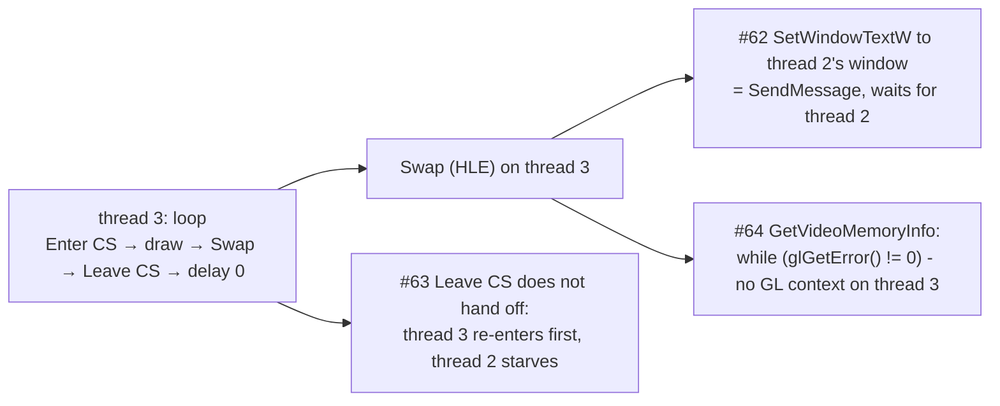

# 설계: 타이틀에서 START 뒤 멈춤 (issue #7)

상태: **구현됨**(rexbox #62~#64). 작업 지시: [20261105-i007](../work-orders/20261105-i007-start-stall.md) · 작업 로그: [20261105-i007](../work-logs/20261105-i007-start-stall.md)

## 1. 요구사항

타이틀 화면에서 START를 누르면 `BGA\SELECT.DAT`, `EZMOD.DAT`를 연 뒤 present가 멈춘다(프레임 약 4400). 스레드 3(로딩 화면 스레드 `sub_0007CB10`)이 CS `0x008433AC`를 쥔 채 HLE 호출 없이 "running"이고, 스레드 2(메인)는 그 CS를 기다린다.

## 2. 원인 (모두 확인됨, rexbox 쪽)

* 로딩 화면 스레드는 타이틀의 CS로 메인 스레드와 그리기를 나눈다. rexbox는 (1) 창 제목을 present한 스레드에서 바꿔 창의 스레드(스레드 2)를 기다렸고, (2) CS를 놓을 때 대기자에게 넘기지 않아 스레드 2가 굶었고, (3) GL 컨텍스트가 스레드 2에만 current라 스레드 3에서 GL 오류 비우기가 끝나지 않았다.
* 그래서 rexbox에 issue 셋을 냈다: [#62](https://github.com/reexec/rexbox/issues/62)(창 스레드), [#63](https://github.com/reexec/rexbox/issues/63)(CS 넘겨주기), [#64](https://github.com/reexec/rexbox/issues/64)(오류 비우기 상한).
* 남은 것: 스레드 3의 GL 작업은 효과가 없다. 로딩 화면은 바뀌지 않는다. [#65](https://github.com/reexec/rexbox/issues/65)의 설계 과제다.

## 3. 검증

창을 띄우고 오디오와 키보드로 타이틀에서 START → 메뉴까지 120초 동안 멈추지 않는지 본다.

---

# Design: the stop after START at the title (issue #7)

Status: **implemented** (rexbox #62–#64). Work order: [20261105-i007](../work-orders/20261105-i007-start-stall.md) · Work log: [20261105-i007](../work-logs/20261105-i007-start-stall.md)

**Requirement.** START at the title screen opens `BGA\SELECT.DAT` and `EZMOD.DAT` and then presents stop (around frame 4400): thread 3 (the loading-screen thread `sub_0007CB10`) is "running" with no HLE call while holding the critical section `0x008433AC`, and thread 2 (the main thread) waits on it.

**Causes (all confirmed, in rexbox), as in the diagram above.** The loading-screen thread shares drawing with the main thread through the title's critical section. rexbox (1) changed the window title from the presenting thread and so waited on the window's thread (thread 2); (2) did not hand a released critical section to its waiter, so thread 2 starved; (3) had the GL context current only on thread 2, so a GL error drain on thread 3 never ended. Three rexbox issues: [#62](https://github.com/reexec/rexbox/issues/62) (the window thread), [#63](https://github.com/reexec/rexbox/issues/63) (the critical-section hand-off) and [#64](https://github.com/reexec/rexbox/issues/64) (a bound on the drain). Left: thread 3's GL work has no effect and the loading screen does not change, a design task for [#65](https://github.com/reexec/rexbox/issues/65).

**Verification.** With the window shown, audio and the keyboard: START at the title and on into the menus, no stop in 120 s.
