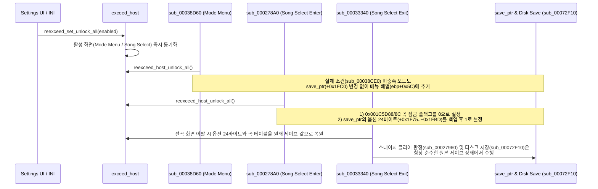

# 모든 곡·채보·옵션·서브 모드 일시 해금 및 오토플레이 설정 (issue #13)

* 상태: **구현됨**
* 관련 이슈: #13
* 선행 문서: [`docs/analysis/exceed-xbe-overview.md`](../analysis/exceed-xbe-overview.md), [`docs/XBE_DESIGN.ko.md`](../XBE_DESIGN.ko.md)

## 목표

1. 사용자의 세이브 파일(`U:\33A446FC39CC\...`)을 훼손하거나 영구 덮어쓰지 않는 **일시 해금(non-destructive temporary unlock)** 방식으로 게임의 모든 해금 요소를 개방한다.
2. 해금 대상은 **모든 곡(Songs)**, **모든 채보(Charts)**, **모든 배속·노트 옵션(Modifiers)**, **모든 서브 모드(Sub-Modes)** 전체다.
3. 게임 내장 오토플레이 봇(`sub_0001E630`)을 구동하는 **Autoplay On/Off** 설정을 함께 제공한다.
4. 두 설정 모두 `reexceed.ini`의 `[Game]` 섹션(`UnlockAll`, `Autoplay`)과 `F1` 설정 창(`Settings`)에서 언제든 켜고 끌 수 있게 하고, 설정을 끄면 원래 상태로 즉시 돌아오게 한다.

## 원본 XBE 해금 구조 분석 결과 (확인됨)

북미판 `default.xbe`의 해금 상태는 세이브 버퍼(`MEM32(0x0084865C)`, 이하 `save_ptr`)와 `.data` 섹션의 곡 메타데이터 테이블(`0x001C5D48`) 두 곳에서 관리된다.

### 1. 세이브 버퍼(`save_ptr`)와 디스크 저장 감지 구조

`sub_00072800`(`0x00072800`)이 할당하는 `save_ptr`(`0x5028`바이트)는 앞쪽 `0x2800`바이트(`save_ptr + 0x0000 .. +0x27FF`)에 현재 메모리상 프로필 데이터를 두고, 뒤쪽 `0x2800`바이트(`save_ptr + 0x2800 .. +0x4FFF`)에 마지막으로 디스크에서 읽거나 디스크에 쓴 사본(shadow copy)을 둔다.

스테이지 종료 또는 옵션 종료 시점(`sub_000364B0`, `sub_00036EB0`, `sub_00037000`)에 게임은 `save_ptr`와 `save_ptr + 0x2800`을 `0x2800`바이트(`0xA00` dword) 비교(`repe cmpsd`)하여 차이가 있을 때만 `sub_00072F10`(`0x00072F10`)을 호출해 Adler-32 체크섬(`+0x2002`)과 Xbox 세이브 서명(`+0x27EC`)을 계산하고 디스크에 저장한다.

### 2. 네 가지 해금 영역과 소비 지점

| 해금 구분 | 세이브 버퍼(`save_ptr`) 오프셋 | 런타임/메모리 소비 지점 | 값 의미 |
| --- | --- | --- | --- |
| 곡·채보 (Songs & Charts) | `+0x1373`(현재 잠금, `4 × 256`B), `+0x1773`(기본 잠금, `4 × 256`B) | `sub_000278A0`(`0x000278A0`)이 선곡 화면 진입 시 `.data`의 `0x001C5D88 + i*0x50 + mode` 및 `0x001C5D8C + i*0x50 + mode`로 복사 | `0` = 해금, `1` = 잠금 |
| 배속·노트 옵션 카테고리 | `+0x1F73 .. +0x1F7D` (11바이트; 기본 잠금 7개: `+0x1F75, +0x1F76, +0x1F79 .. +0x1F7D`) | 선곡 화면 발판 커맨드(`sub_000289A0`), 옵션 메뉴(`sub_00034C60`, `sub_000350B0`, `sub_00035800`) | `1` = 해금, `0` = 잠금 |
| 배속·노트 세부 옵션 | `+0x1F89 .. +0x1FBD` (`11 × 5`슬롯 중 기본 잠금 17바이트) | 선곡 화면 옵션 메뉴 좌우 선택(`sub_00035EB0`, `sub_00035F00`) | `1` = 해금, `0` = 잠금 |
| 서브 모드 (11개) | `+0x1FC0 .. +0x1FCA` (11바이트, 해금 알림 기록) | `sub_00038D60`(`0x00038D60`)이 `sub_00038CE0`(`0x00038CE0`)을 호출해 모드 메뉴 객체의 활성 목록(`ebp + 0x58` 개수, `ebp + 0x5C` 배열)을 구성 | `sub_00038CE0` 반환 `AL = 1` = 해금 |

### 3. 내장 오토플레이(Autoplay) 구조 (확인됨)

* 게임 시작 시 `sub_00022E10`(`0x0002326A`)은 메인 스테이지 씬(`"PLAY"`, 크기 `0x994`, 생성자 `sub_00013440`)을 할당하고 그 기저 주소를 전역 포인터 `MEM32(0x00825114)`에 저장한다.
* 원본 개발자 콘솔 명령 처리기 `sub_00011460`(`0x00011509`)의 `/autoplay` 명령은 `"PLAY"` 씬 객체의 `MEM8(play_ptr + 0x39D)`(`sub_00017530` 기준 `ebp = play_ptr + 0x110`이므로 `MEM8(ebp + 0x28D)`)를 `0`/`1`로 토글한다.
* 스테이지 프레임 갱신 함수 `sub_00017530`(`0x00017530`)은 매 프레임 `MEM8(ebp + 0x28D) != 0`이면:
  1. `MEM8(ebp + 5) = 1`(`MEM8(play_ptr + 0x115) = 1`)을 표시해 오토플레이 플레이가 Internet Ranking(`"IR"`) 코드 발급으로 이어지지 않게 하고, 판정 처리(`sub_0001DB80`)에서 누적 스텝 수(`save_ptr + 0x367`) 증가를 건너뛴다.
  2. 현재 프레임의 가상 발판 입력 상태를 초기화한 뒤(`0x00017C68`), 오토플레이 봇 `sub_0001E630`(`0x0001E630`)을 호출해 1P/2P/Double 모든 노트를 Perfect 타이밍으로 자동 입력한다.
  3. 데모/어트랙트 모드 비트(`MEM32(0x008485E8) & 0x01000000`)와 달리 35초(`0x88B8` ms) 조기 종료나 버튼 입력 시 중단 없이 곡 끝까지 정상 진행한다.

## 일시 해금 및 오토플레이 설계

세이브 파일을 오염시키지 않으면서 네 영역을 모두 일시 해금하고 실시간 토글을 지원하기 위해, 선곡·모드 진입/종료 경계의 작은 함수 세 개(`sub_000278A0`, `sub_00033340`, `sub_00038D60`)를 디컴파일하고 호스트 훅(`exceed_host`)과 연결한다.

### 1. 서브 모드 일시 해금 (`sub_00038D60`)

* `sub_00038D60`(`0x00038D60`, 92바이트, 31명령어)은 모드 인덱스 `edi = 0..10`에 대해 `sub_00038CE0`을 호출한다.
* `sub_00038CE0`이 `1`을 반환하면(실제 세이브 조건 달성) 원본과 동일하게 `MEM8(save_ptr + edi + 0x1FC0)`을 갱신하고 신규 해금 알림(`sub_000369F0`)을 띄운 뒤 `ebp + 0x5C` 목록에 추가한다.
* `sub_00038CE0`이 `0`을 반환하더라도 `reexceed_host_unlock_all() != 0`이면, `save_ptr + 0x1FC0`을 건드리지 않고(가짜 알림도 띄우지 않고) `ebp + 0x5C` 활성 모드 목록에만 `edi`를 추가한다.
* 모드 선택 화면에 머무는 동안 사용자가 `F1` 설정 창에서 토글하면, 마지막 활성 `ModeMenu` 객체(`MEM32(ebp) == 0x001B91DC`)의 목록(`+0x58`, `+0x5C`)을 즉시 재구성한다.

### 2. 곡·채보 및 배속·노트 옵션 일시 해금 (`sub_000278A0`, `sub_00033340`)

* **선곡 화면 진입(`sub_000278A0`, `0x000278A0`, 181바이트, 57명령어)**:
  * 원본과 동일하게 `save_ptr + 0x1773` 및 `+0x1373`을 기준으로 신규 해금 곡(`out_newly_unlocked_id`)을 판정한 뒤,
  * `reexceed_host_unlock_all() != 0`이면 활성 곡(`MEM32(0x001C5D48 + i * 0x50) != 0xFFFFFFFF` 및 `MEM8(0x001C5D90 + i * 0x50) == 0`)의 `.data` 잠금 플래그(`0x001C5D88`, `0x001C5D8C`)를 모두 `0`(해금)으로 채운다.
  * 동시에 선곡 화면 내부의 옵션 메뉴(`sub_00034C60`~`sub_00035F00`)와 발판 커맨드(`sub_000289A0`)가 읽는 `save_ptr`의 해금형 옵션 24바이트(`+0x1F75..+0x1FBD`)를 호스트 배열에 백업하고 `save_ptr`와 `save_ptr + 0x2800` 양쪽에 `1`로 기록한다.
* **선곡 화면 이탈(`sub_00033340`, `0x00033340`, 202바이트, 49명령어, vtable[3])**:
  * 선곡 화면 씬이 소멸할 때(`loc_000239B6`에서 `vtable[3]` 호출) 백업해 둔 옵션 24바이트를 `save_ptr`와 `save_ptr + 0x2800`에 즉시 복원하고, 곡 잠금 테이블(`0x001C5D88`, `0x001C5D8C`)도 `save_ptr + 0x1373`/`+0x1773`의 원래 값으로 되돌린다.
  * 선곡 중 선택한 배속·노트 효과 자체는 플레이어 상태(`0x008485E8`, `0x00825760 + 0x184`)에 이미 반영되어 있으므로 인게임 플레이에는 그대로 적용되며, 스테이지 종료 후 실행되는 해금 판정(`sub_00027960`)과 디스크 저장(`sub_00072F10`)은 오염 없는 원본 세이브 데이터를 기준으로 동작한다.
* **선곡 화면 중 실시간 토글**:
  * 선곡 화면 활성 상태에서 `reexceed_set_unlock_all`이 호출되면 4개 모드(`0..3`)의 곡 잠금 테이블(`0x001C5D88`, `0x001C5D8C`)과 옵션 24바이트를 즉시 적용하거나 백업에서 복원한다.

### 3. 오토플레이(Autoplay) 동기화

* 모드 선택 진입(`sub_00038D60`), 선곡 화면 진입(`sub_000278A0`), 그리고 `F1` 설정 창 토글(`reexceed_set_autoplay`) 시점에 `"PLAY"` 씬 객체 포인터 `play_ptr = MEM32(0x00825114)`가 유효하면 `MEM8(play_ptr + 0x39D)`를 `reexceed_host_autoplay() ? 1 : 0`으로 동기화한다.
* `sub_00017530`이 매 프레임 `MEM8(play_ptr + 0x39D)`(`MEM8(ebp + 0x28D)`)를 읽으므로, 곡 플레이 도중 `F1` 설정 창에서 `Autoplay`를 켜거나 꺼도 다음 프레임부터 즉시 반영된다.
* `reexceed_host_autoplay() == 0`이고 이전에 호스트가 오토플레이를 켠 적이 없을 때는 게스트 메모리를 전혀 건드리지 않아 원본 생성 코드(`_gen`)와의 100% 동치를 유지한다.

### 4. 호스트 계약 및 앱 설정 연결

* `include/reexceed/exceed_host.h` / `src/game/exceed/exceed_host.c`:
  * `reexceed_set_unlock_all(int enabled)`, `reexceed_host_unlock_all(void)`, `reexceed_set_autoplay(int enabled)`, `reexceed_host_autoplay(void)`를 추가한다.
  * 상태가 바뀔 때 디컴파일 모듈의 동기화 함수(`reexceed_decomp_sync_unlock_all`, `reexceed_decomp_sync_autoplay`)를 호출해 현재 화면 및 스테이지에 즉시 반영한다.
* `src/app/settings.h`, `src/app/settings.cpp`, `src/app/settings_ui.cpp`, `src/app/main.cpp`:
  * `Settings::unlock_all` 및 `Settings::autoplay`(기본값 `false`)를 추가하고 `reexceed.ini`의 `[Game]` 섹션 `UnlockAll`, `Autoplay` 키로 읽고 쓴다.
  * `F1` 설정 창에 `Game` 섹션과 `Unlock all songs, modes, and modifiers (temporary)`, `Autoplay` 체크박스를 추가한다.

## 검증 전략

1. `tools/decomp_check/main.cpp`에 `sub_000278A0`, `sub_00029F80`, `sub_00038D60` 세 함수의 parity 테스트(`unlock_all = 0`, `autoplay = 0`에서 `sub_XXXXXXXX`와 `sub_XXXXXXXX_gen`의 레지스터·메모리 결과 일치)와 `unlock_all = 1` 해금·복원 및 `autoplay = 1` 동기화·복원 검증을 추가한다.
2. Win32 `Release` 및 `Debug` 구성에서 전체 빌드(경고·오류 0)와 `ctest` 통과를 확인한다.

---

# Temporary Unlock-All and Autoplay Settings (issue #13)

* Status: **implemented**
* Related issue: #13
* Preceding documents: [`docs/analysis/exceed-xbe-overview.md`](../analysis/exceed-xbe-overview.md), [`docs/XBE_DESIGN.en.md`](../XBE_DESIGN.en.md)

## Goals

1. Unlock all progression-gated content in the game using a **non-destructive temporary unlock** that never corrupts or permanently overwrites the user's save file (`U:\33A446FC39CC\...`).
2. Cover **all songs**, **all charts**, **all speed and note modifiers**, and **all sub-modes**.
3. Provide an **Autoplay On/Off** setting backed by the game's built-in autoplay bot (`sub_0001E630`).
4. Expose both toggles in `reexceed.ini` (`[Game]` `UnlockAll`, `Autoplay`) and the `F1` `Settings` window so turning them off immediately restores normal state.

## Original XBE Unlock Architecture Findings (Confirmed)

In the North America `default.xbe`, unlock state is held in two places: the heap-allocated save buffer (`MEM32(0x0084865C)`, hereafter `save_ptr`) and the `.data` song metadata table (`0x001C5D48`).

### 1. Save Buffer (`save_ptr`) and Dirty-Check Shadow Copy

`sub_00072800` (`0x00072800`) allocates `0x5028` bytes at `save_ptr`: the first `0x2800` bytes (`save_ptr + 0x0000 .. +0x27FF`) hold the active in-memory profile, and the second `0x2800` bytes (`save_ptr + 0x2800 .. +0x4FFF`) hold a shadow copy of the last disk load/save.

When leaving options or finishing a stage (`sub_000364B0`, `sub_00036EB0`, `sub_00037000`), the game compares `save_ptr` against `save_ptr + 0x2800` (`0x2800` bytes via `repe cmpsd`) and calls `sub_00072F10` (`0x00072F10`) to compute the Adler-32 checksum (`+0x2002`) and Xbox save signature (`+0x27EC`) and write to disk only when the two buffers differ.

### 2. The Four Unlock Domains and Their Consumers

| Domain | Save Buffer (`save_ptr`) Offset | Runtime / Memory Consumer | Value Semantics |
| --- | --- | --- | --- |
| Songs & Charts | `+0x1373` (active lock, `4 × 256` B), `+0x1773` (default lock, `4 × 256` B) | `sub_000278A0` (`0x000278A0`) copies them to `0x001C5D88 + i*0x50 + mode` and `0x001C5D8C + i*0x50 + mode` when entering Song Select | `0` = unlocked, `1` = locked |
| Option Categories | `+0x1F73 .. +0x1F7D` (11 bytes; 7 locked by default: `+0x1F75, +0x1F76, +0x1F79 .. +0x1F7D`) | Song Select pad step codes (`sub_000289A0`) and Option Menu (`sub_00034C60`, `sub_000350B0`, `sub_00035800`) | `1` = unlocked, `0` = locked |
| Option Sub-Items | `+0x1F89 .. +0x1FBD` (17 bytes locked by default across `11 × 5` slots) | Song Select Option Menu left/right selection (`sub_00035EB0`, `sub_00035F00`) | `1` = unlocked, `0` = locked |
| Sub-Modes (11) | `+0x1FC0 .. +0x1FCA` (11 bytes, unlock notification history) | `sub_00038D60` (`0x00038D60`) calls `sub_00038CE0` (`0x00038CE0`) to populate the active mode list (`ebp + 0x58` count, `ebp + 0x5C` array) | `sub_00038CE0` returns `AL = 1` = unlocked |

### 3. Built-In Autoplay Architecture (Confirmed)

* At startup, `sub_00022E10` (`0x0002326A`) allocates the main gameplay stage scene (`"PLAY"`, size `0x994`, constructor `sub_00013440`) and stores its base address in `MEM32(0x00825114)`.
* The `/autoplay` command in the original developer console handler `sub_00011460` (`0x00011509`) toggles `MEM8(play_ptr + 0x39D)` (`MEM8(ebp + 0x28D)` in `sub_00017530`, where `ebp = play_ptr + 0x110`) between `0` and `1`.
* Each frame in `sub_00017530` (`0x00017530`), when `MEM8(ebp + 0x28D) != 0`:
  1. It sets `MEM8(ebp + 5) = 1` (`MEM8(play_ptr + 0x115) = 1`) so Autoplay runs do not issue Internet Ranking (`"IR"`) codes, and `sub_0001DB80` skips incrementing the save file's lifetime step counter (`save_ptr + 0x367`).
  2. It resets the virtual pad press state (`0x00017C68`) and calls the autoplay bot `sub_0001E630` (`0x0001E630`) to hit every 1P/2P/Double note with Perfect timing.
  3. Unlike attract/demo mode (`MEM32(0x008485E8) & 0x01000000`), it plays the entire song to completion without aborting after 35 seconds (`0x88B8` ms) or on controller input.

## Temporary Unlock and Autoplay Design

To unlock all four domains without polluting the save file while supporting live toggling, we decompile three small boundary functions (`sub_000278A0`, `sub_00033340`, `sub_00038D60`) and connect them to `exceed_host`.

### 1. Sub-Mode Temporary Unlock (`sub_00038D60`)

* `sub_00038D60` (`0x00038D60`, 92 bytes, 31 instructions) iterates `edi = 0..10` and calls `sub_00038CE0`.
* When `sub_00038CE0` returns `1` (genuinely unlocked in the save), `sub_00038D60` updates `MEM8(save_ptr + edi + 0x1FC0)` and fires the unlock notification (`sub_000369F0`) as in the original, then appends `edi` to `ebp + 0x5C`.
* When `sub_00038CE0` returns `0` and `reexceed_host_unlock_all() != 0`, `sub_00038D60` appends `edi` to `ebp + 0x5C` without touching `save_ptr + 0x1FC0` and without firing fake unlock popups.
* Toggling the setting while on the Mode Select screen immediately rebuilds the active `ModeMenu` object's list (`MEM32(ebp) == 0x001B91DC`).

### 2. Song/Chart and Option Temporary Unlock (`sub_000278A0`, `sub_00033340`)

* **Entering Song Select (`sub_000278A0`, `0x000278A0`, 181 bytes, 57 instructions)**:
  * Evaluates `out_newly_unlocked_id` from `save_ptr + 0x1773` and `+0x1373` as in the original.
  * When `reexceed_host_unlock_all() != 0`, sets the `.data` lock bytes (`0x001C5D88` and `0x001C5D8C`) of all active songs to `0` (unlocked), backs up the 24 unlockable option bytes (`+0x1F75..+0x1FBD`) from `save_ptr`, and sets them to `1` in both `save_ptr` and `save_ptr + 0x2800`.
* **Leaving Song Select (`sub_00033340`, `0x00033340`, 202 bytes, 49 instructions, vtable[3])**:
  * Restores the 24 option bytes to `save_ptr` and `save_ptr + 0x2800` and restores the `.data` song lock bytes from `save_ptr + 0x1373`/`+0x1773` before Song Select is destroyed (`vtable[3]` called at `loc_000239B6`).
  * Modifiers chosen during Song Select are already stored in player state (`0x008485E8`, `0x00825760 + 0x184`) and remain active during gameplay, while post-stage unlock evaluation (`sub_00027960`) and disk saving (`sub_00072F10`) always operate on the clean original save buffer.
* **Live Toggling During Song Select**:
  * Calling `reexceed_set_unlock_all` while Song Select is active immediately applies or restores the `.data` song lock bytes across all 4 modes (`0..3`) and the 24 option bytes.

### 3. Autoplay Synchronization

* When entering Mode Select (`sub_00038D60`), entering Song Select (`sub_000278A0`), or toggling the setting in the `F1` `Settings` window (`reexceed_set_autoplay`), if the `"PLAY"` scene object pointer `play_ptr = MEM32(0x00825114)` is non-null, `MEM8(play_ptr + 0x39D)` is synchronized to `reexceed_host_autoplay() ? 1 : 0`.
* Because `sub_00017530` reads `MEM8(play_ptr + 0x39D)` (`MEM8(ebp + 0x28D)`) every frame, toggling `Autoplay` in the `F1` `Settings` window even mid-song takes effect on the very next frame.
* When `reexceed_host_autoplay() == 0` and autoplay has not been applied, guest memory is untouched, preserving bit-for-bit parity with the generated functions (`_gen`).

### 4. Host Contract and App Settings

* `include/reexceed/exceed_host.h` / `src/game/exceed/exceed_host.c`:
  * Add `reexceed_set_unlock_all(int enabled)`, `reexceed_host_unlock_all(void)`, `reexceed_set_autoplay(int enabled)`, and `reexceed_host_autoplay(void)`, invoking `reexceed_decomp_sync_unlock_all()` and `reexceed_decomp_sync_autoplay()` on state changes.
* `src/app/settings.h`, `src/app/settings.cpp`, `src/app/settings_ui.cpp`, `src/app/main.cpp`:
  * Add `bool unlock_all = false;` and `bool autoplay = false;` to `Settings`, persisted under `[Game]` `UnlockAll` and `Autoplay` in `reexceed.ini`.
  * Add a `Game` section with `Unlock all songs, modes, and modifiers (temporary)` and `Autoplay` checkboxes in the `F1` `Settings` window.

## Verification Strategy

1. Extend `tools/decomp_check/main.cpp` with parity tests for `sub_000278A0`, `sub_00033340`, and `sub_00038D60` (`unlock_all = 0`, `autoplay = 0` matching `sub_XXXXXXXX_gen`) and functional tests for temporary unlock/restoration (`unlock_all = 1` -> `0`) and autoplay synchronization (`autoplay = 1` -> `0`).
2. Build Win32 `Release` and `Debug` with zero warnings/errors and pass all `ctest` suites.
