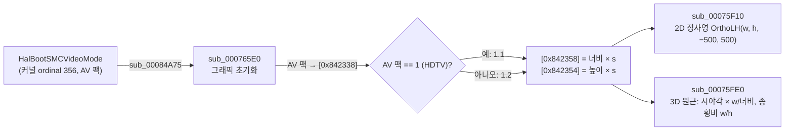

# 원본 크기 출력 설정: TV 오버스캔 축소 끄기 (issue #14)

* 상태: **구현됨**
* 관련 이슈: #14
* 선행 문서: [`docs/analysis/exceed-xbe-overview.md`](../analysis/exceed-xbe-overview.md) 12절

## 문제

게임 화면 전체(2D와 3D)가 창의 약 83%로 줄어 가운데에 그려지고, 둘레는 검은 테두리가 된다. 1280×960 창에서 그림은 1066×800이다(640/768 = 0.833).

## 원본 동작 (확인됨)

* `sub_000765E0`(`0x000765E0`, 그래픽 초기화)은 백 버퍼 크기 정수를 `[0x842334]`(너비 640), `[0x842398]`(높이 480)에 두고, `HalBootSMCVideoMode` 값(`sub_00084A75`)을 `[0x842338]`에 둔 뒤 배율 `s`를 고른다. 값이 1(HDTV 팩)이면 `s = 1.1`(`[0x1BD3BC]`), 아니면 `s = 1.2`(`[0x1BD46C]`).
* 가상 화면 크기 `[0x842358] = (float)너비 × s`, `[0x842354] = (float)높이 × s`(640×480이면 768×576)를 쓰고 곧바로 `sub_00075F10`을 부른다.
* `sub_00075F10`(2D 설정, 호출자 30곳)은 View를 항등으로 두고 `D3DXMatrixOrthoLH(w=[0x842358], h=[0x842354], −500, 500)`을 Projection으로 쓴다. 2D 좌표는 640×480 픽셀이므로 그림이 `1/s`로 줄어든다.
* `sub_00075FE0`(3D 설정, 호출자 9곳)은 시야각 인자에 `[0x842358] / 너비`를 곱하고 종횡비를 `[0x842358] / [0x842354]`로 쓴다. 3D도 같은 비율로 줄어든다.
* 두 전역을 읽는 곳은 이 두 함수뿐이고, 쓰는 곳은 `sub_000765E0`뿐이다.
* 즉 이것은 CRT TV의 오버스캔(화면 가장자리가 잘려 보이는 현상)을 보정하는 원본 동작이다. rexbox는 `HalBootSMCVideoMode`를 0(SCART)으로 보고하므로 1.2가 적용된다. 원본에는 배율 1.0 경로가 없다.

## 설계

* 설정 `[Graphics] FullSizePicture`(기본 **켜짐**)와 `F1` 설정 창 Graphics 탭의 체크박스 `Full-size picture`를 둔다.
* 켜져 있으면 가상 화면 크기를 백 버퍼 크기와 같게(배율 1.0) 만든다. 2D와 3D가 함께 창을 가득 채운다. 원래 화면 밖이던 검은 테두리 사각형은 화면 밖으로 나간다.
* 구현은 호스트 어댑터 `src/game/exceed/decomp/full_size_picture.c`다.
  * `sub_00075F10`을 대체하는 함수가 먼저 `sync_virtual_size()`를 부르고 lift 본문 `sub_00075F10_gen`을 부른다. 초기화가 두 전역을 쓴 직후 `sub_00075F10`을 부르므로, 첫 2D·3D 설정부터 새 값이 쓰인다.
  * `sync_virtual_size()`: 너비·높이 정수가 0이면(초기화 전) 아무것도 하지 않는다. 켜짐이면 `[0x842358] = (float)너비`, `[0x842354] = (float)높이`. 꺼짐이고 이전에 덮어쓴 적이 있으면 원본 식(`[0x842338] == 1`이면 `[0x1BD3BC]`, 아니면 `[0x1BD46C]`를 곱함, 단정도)으로 원래 값을 되돌린다. 덮어쓴 적이 없으면 게스트 메모리를 건드리지 않는다(원본과 동치).
  * `reexceed_set_full_size_picture(int)`(`exceed_host`)는 상태를 바꾸고 `reexceed_decomp_sync_full_size_picture()`로 전역을 즉시 갱신한다. 실행 중에 바꾸면 다음 `sub_00075F10`/`sub_00075FE0` 호출(장면마다)부터 반영된다. 게스트가 아직 이 함수를 한 번도 부르지 않았으면(게스트 메모리 준비 전) 쓰지 않는다.
* 원본 로직은 바꾸지 않는다. 꺼짐이면 원본과 같은 그림이다.

## 검증 전략

1. `reexceed_decomp_check`에 `TestFullSizePicture`를 더한다. 너비 640·높이 480·AV 팩 0과 1에서: 켜짐 → 전역이 640/480, 꺼짐 → 원본 식의 768/576(팩 0), 704/528(팩 1)로 복원, 덮어쓰지 않았으면 메모리 불변.
2. Win32 Release 빌드와 `ctest`.
3. 실행해 게임플레이 화면이 창을 가득 채우는지(검은 테두리 없음), 설정을 끄면 원래의 축소 화면으로 돌아오는지 본다.

---

# Full-Size Picture Setting: Turning Off the TV Overscan Shrink (issue #14)

* Status: **implemented**
* Related issue: #14
* Preceding document: [`docs/analysis/exceed-xbe-overview.md`](../analysis/exceed-xbe-overview.md) section 12

## Problem

The whole picture (2D and 3D) is drawn at about 83% of the window, centered, with a black border around it. In a 1280x960 window the picture is 1066x800 (640/768 = 0.833).

## Original behavior (confirmed)

* `sub_000765E0` (graphics init) keeps the back buffer size as integers in `[0x842334]` (width 640) and `[0x842398]` (height 480), stores the `HalBootSMCVideoMode` value (kernel ordinal 356, the AV pack, read by `sub_00084A75`) in `[0x842338]`, and picks a scale `s`: 1.1 (`[0x1BD3BC]`) for the HDTV pack (1), 1.2 (`[0x1BD46C]`) otherwise.
* It writes the virtual screen size `[0x842358] = (float)width × s`, `[0x842354] = (float)height × s` (768x576 for 640x480) and calls `sub_00075F10` right after.
* `sub_00075F10` (2D setup, 30 callers) sets View to identity and Projection to `D3DXMatrixOrthoLH(w=[0x842358], h=[0x842354], −500, 500)`. 2D coordinates are 640x480 pixels, so the picture shrinks by `1/s`.
* `sub_00075FE0` (3D setup, 9 callers) multiplies its field-of-view argument by `[0x842358] / width` and uses `[0x842358] / [0x842354]` as the aspect, so 3D shrinks by the same ratio.
* Only these two functions read the globals, and only `sub_000765E0` writes them.
* This is the original's compensation for CRT TV overscan. rexbox reports `HalBootSMCVideoMode` 0 (SCART), so 1.2 applies. The original has no 1.0 path.

## Design

* A setting `[Graphics] FullSizePicture` (default **on**) and a `Full-size picture` checkbox in the `F1` Settings window's Graphics tab.
* On makes the virtual screen size equal to the back buffer size (scale 1.0): 2D and 3D fill the window together, and the black border quads move off screen.
* The host adapter `src/game/exceed/decomp/full_size_picture.c`:
  * The replacement of `sub_00075F10` calls `sync_virtual_size()` and then the lifted body `sub_00075F10_gen`. Init calls `sub_00075F10` right after writing the globals, so the first 2D and 3D setups already use the new values.
  * `sync_virtual_size()`: nothing when the width or height integer is 0 (before init). On: `[0x842358] = (float)width`, `[0x842354] = (float)height`. Off after an earlier override: the original values again by the original formula (`[0x1BD3BC]` when `[0x842338] == 1`, else `[0x1BD46C]`, single precision). Off with no earlier override: guest memory is left untouched (identical to the original).
  * `reexceed_set_full_size_picture(int)` (`exceed_host`) changes the state and updates the globals at once through `reexceed_decomp_sync_full_size_picture()`; a change while running shows from the next `sub_00075F10`/`sub_00075FE0` call (every scene). Before the guest has called the function once (guest memory not ready), nothing is written.
* The original logic is unchanged; off gives the original picture.

## Verification

1. `TestFullSizePicture` in `reexceed_decomp_check`: with width 640, height 480 and AV pack 0 and 1, on → globals 640/480, off → restored by the original formula to 768/576 (pack 0) and 704/528 (pack 1), and memory unchanged when nothing was overridden.
2. Win32 Release build and `ctest`.
3. Run it: gameplay fills the window (no black border), and turning the setting off brings back the original shrunken picture.
