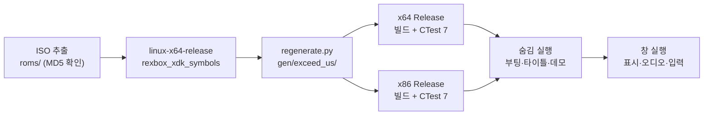

# 설계: Linux 실기에서 재컴파일 코드 생성, x64·x86 빌드, 게임 실행 (issue #16)

* 상태: **x64 완료, x86·X11은 rexbox로 분리**
* 관련 이슈: #16
* 선행 문서: [설계 i001](20261103-i001-project-bootstrap.md), [Linux 가이드](../guides/linux-setup-and-build.md), reCT3의 [설계 i025](https://github.com/reexec/reCT3/blob/main/docs/design/20261025-i025-linux-build.md)

## 1. 요구사항

Linux 실기에서 재컴파일 코드를 생성하고, Linux x64와 x86으로 게임을 빌드해 실행한다.

## 2. 현재 구조

* `CMakePresets.json`(`linux-{x64,x86}-{debug,release}`, Ninja), `scripts/build_linux.sh`, Linux 가이드, CI의 Linux x64 작업이 있다. 모두 reCT3 i025에서 가져왔다.
* 확인된 것은 WSL2(Ubuntu 24.04, GCC 13)에서 **재컴파일 코드 없이** 빌드, CTest 6/6, 앱의 로드 단계까지다. Linux에서 `regenerate.py`를 돌린 적도, 생성 코드를 GCC로 컴파일하거나 실행한 적도 없다.
* `regenerate.py`는 이미 Linux 프리셋 트리에서 `rexbox_xdk_symbols`를 찾는다.
* `scripts/build_linux.sh`는 git에 100644로 들어 있어 받은 그대로는 `scripts/build_linux.sh`로 실행되지 않는다(CI는 `bash`로 부른다).
* rexbox는 v0.0.26에 고정되어 있다. reCT3에서 같은 rexbox Linux 계층 위에서 타이틀이 실기(Ubuntu 26.04)까지 돌았다.

## 3. 설계

* **게임 파일**: 사용자가 extract-xiso로 ISO를 `roms/`에 푼다(가이드 3절의 배치; `roms/`와 `*.iso`는 gitignore). 생성과 실행은 기본 경로(`roms/DEFAULT.XBE`, 게임 디렉터리 `roms`)를 쓴다. `DEFAULT.XBE`의 MD5가 `575f861eb700e86a82c0ad530dc4a310`인지 확인한다.
* **생성**: 가이드 4절 그대로. 파이프라인은 Python과 xboxrecomp 도구뿐이라 플랫폼 중립으로 본다.
* **빌드**: x64·x86 Release를 `scripts/build_linux.sh`로. 깨지는 곳은 원인 계층에서 고친다. 타이틀·앱이면 이 저장소에서, rexbox(플랫폼 계층, HLE, 호스트 플래그)면 rexbox issue로 한다. 생성 코드(`gen/`)는 직접 고치지 않는다. lifter 결함이면 `scripts/recomp/lifter_patches.py`로 한다.
* **실행**: 숨김(`REXBOX_DISPLAY=hidden REXBOX_AUDIO=none REXBOX_WATCHDOG=100`)으로 부팅 로고, 타이틀, 어트랙트 데모까지 본 뒤 창 실행(표시·오디오·입력)을 사용자가 확인한다.
* **저장소 정리**: `scripts/build_linux.sh`를 100755로 바꾼다. 가이드는 실기에서 확인한 것으로 고치고, README의 플랫폼 표를 갱신한다.

### 위험(미확정 → 실행으로 확인)

* GCC 15 / CMake 4.2: 새 경고(`rexbox_strict_warnings`), 오래된 `cmake_minimum_required`를 쓰는 서드파티의 configure 실패.
* 생성 코드의 GCC 컴파일: 크기(시간·메모리), MSVC에서만 통과하던 구문.
* 64비트 호스트: 생성 코드의 포인터 가정. reCT3에서는 문제가 없었다.
* Win32에서 고친 것(#6, #7, #9)이 플랫폼 차이(스레드 스케줄, 타이밍)로 Linux에서 다시 드러날 수 있다.

## 4. 검증

* 생성이 오류 없이 끝나고 `gen/exceed_us/gen/`이 만들어진다.
* x64·x86 Release 빌드 오류 0(새 경고는 목록으로 남긴다), CTest 7/7.
* 숨김 실행: 멈춤, `no target`, stall 없이 데모까지(로그의 draws·fps).
* 창 실행: 사용자가 표시, 소리, 입력, 곡 선택과 플레이를 확인한다.

## 5. 결과와 범위 결정 (2026-11-10)

* 생성, x64·x86 Release 빌드(경고 0), CTest 7/7, x64의 Wayland 실행(부팅·타이틀·어트랙트, 60 fps)은 설계대로 됐다. 위험으로 적은 GCC 15·CMake 4.2, 생성 코드의 GCC 컴파일, 64비트 호스트는 문제가 없었다.
* 두 가지가 설계 밖에서 드러났다. 둘 다 원인 계층이 rexbox(플랫폼·D3D8)이므로 rexbox issue로 분리하고([rexbox #85](https://github.com/reexec/rexbox/issues/85), [rexbox #86](https://github.com/reexec/rexbox/issues/86)), #16은 x64로 마무리한다(사용자 결정). 사용자가 x64 창 실행을 확인했다.
  * **X11**: x64·x86 모두 첫 그림 직후 게임 메인 스레드(thread 1, GL 컨텍스트를 가진 스레드)가 `eax 1`로 반환하고, 다른 게스트 스레드의 `DrawVerticesUP`가 컨텍스트 없이 GL을 불러 `libGLdispatch` 안에서 fault한다. 반환 원인은 미확정이다.
  * **x86 + NVIDIA Wayland**: `eglCreateWindowSurface`가 실패해 창이 없다. 32비트 GL/EGL 라이브러리는 설치되어 있다. 이 실행은 SIGTERM으로 끝나지 않았다.
* 배제한 가설: i386의 구조체 정렬(x64도 X11에서 재현), 모니터 주사율 차이(게스트에는 게스트가 준 값이 보인다).

---

# Design: Generating the Recompiled Code, Building x64 and x86 and Running the Game on a Linux Machine (issue #16)

* Status: **x64 done; x86 and X11 split off to rexbox**
* Related issue: #16
* Preceding documents: [design i001](20261103-i001-project-bootstrap.md), [Linux guide](../guides/linux-setup-and-build.md), reCT3's [design i025](https://github.com/reexec/reCT3/blob/main/docs/design/20261025-i025-linux-build.md)

## 1. Requirement

Generate the recompiled code on a Linux machine, then build the game for Linux x64 and x86 and run it.

## 2. Current structure

* `CMakePresets.json` (`linux-{x64,x86}-{debug,release}`, Ninja), `scripts/build_linux.sh`, the Linux guide and CI's Linux x64 job exist, all carried over from reCT3 i025.
* What has been checked is the build **without recompiled code**, CTest 6/6 and the app's load stage on WSL2 (Ubuntu 24.04, GCC 13). `regenerate.py` has never run on Linux, and the generated code has never been compiled by GCC or run.
* `regenerate.py` already looks for `rexbox_xdk_symbols` in the Linux preset trees.
* `scripts/build_linux.sh` is stored as 100644, so a fresh clone cannot run it as `scripts/build_linux.sh` (CI calls it through `bash`).
* rexbox is pinned at v0.0.26. reCT3 has run its title on the same rexbox Linux layer, on a Linux machine (Ubuntu 26.04) too.

## 3. Design

The diagram above shows the flow.

* **Game files**: the user extracts the ISO with extract-xiso into `roms/` (the layout of section 3 of the guide; `roms/` and `*.iso` are ignored); generation and the run use the default paths (`roms/DEFAULT.XBE`, game directory `roms`). Check that `DEFAULT.XBE`'s MD5 is `575f861eb700e86a82c0ad530dc4a310`.
* **Generation**: as in section 4 of the guide. The pipeline is Python and the xboxrecomp tools only, so it is taken to be platform-neutral.
* **Build**: x64 and x86 Release through `scripts/build_linux.sh`. What breaks is fixed in the layer that causes it: title or app code here, rexbox (platform layer, HLE, host flags) through a rexbox issue. The generated code (`gen/`) is never edited by hand; lifter defects go to `scripts/recomp/lifter_patches.py`.
* **Run**: hidden (`REXBOX_DISPLAY=hidden REXBOX_AUDIO=none REXBOX_WATCHDOG=100`) through the boot logos, the title and the attract demo, then a windowed run (picture, audio, input) checked by the user.
* **Repository**: make `scripts/build_linux.sh` 100755, correct the guide with what the machine showed, and update the README platform table.

### Risks (open, settled by running)

* GCC 15 / CMake 4.2: new warnings (`rexbox_strict_warnings`), third-party configure failures from old `cmake_minimum_required` values.
* GCC compiling the generated code: its size (time, memory) and constructs only MSVC accepted.
* 64-bit host: pointer assumptions in the generated code; none showed in reCT3.
* Fixes made on Win32 (#6, #7, #9) may resurface through platform differences (thread scheduling, timing).

## 4. Verification

* Generation finishes without errors and produces `gen/exceed_us/gen/`.
* x64 and x86 Release build with no errors (new warnings are listed), CTest 7/7.
* Hidden run: no hang, `no target` or stall through the demo (draws and fps in the log).
* Windowed run: the user checks the picture, sound, input, song select and play.

## 5. Results and scope decision (2026-11-10)

* Generation, the x64 and x86 Release builds (no warnings), CTest 7/7 and the x64 run on Wayland (boot, title, attract, 60 fps) went as designed; the listed risks (GCC 15 and CMake 4.2, GCC compiling the generated code, the 64-bit host) did not materialize.
* Two problems appeared outside the design. Both sit in rexbox (platform layer, D3D8), so they go to rexbox issues ([rexbox #85](https://github.com/reexec/rexbox/issues/85), [rexbox #86](https://github.com/reexec/rexbox/issues/86)) and #16 closes with x64 (the user's decision); the user confirmed the x64 windowed run.
  * **X11**: on x64 and x86 the title's main thread (thread 1, which holds the GL context) returns with `eax 1` right after the first picture, and another guest thread's `DrawVerticesUP` then calls GL with no context and faults inside `libGLdispatch`. Why the main thread returns is open.
  * **x86 on NVIDIA Wayland**: `eglCreateWindowSurface` fails, so there is no window, although the 32-bit GL/EGL libraries are installed; that run did not end on SIGTERM.
* Hypotheses ruled out: i386 struct alignment (x64 reproduces on X11) and the monitor refresh difference (the guest sees the rate it asked for).
