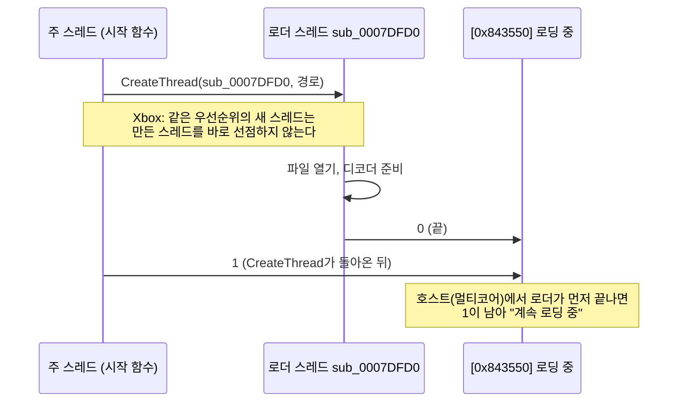

# 음악 로더 스레드와 "로딩 중" 플래그의 경쟁 (issue #9 후속)

* 상태: **구현됨** (`05864dd`, 사용자 재현 시험 남음)
* 관련 이슈: #9(곡 음악 무음, 재현되지 않아 닫았던 것)
* 선행: [`docs/design/20261106-i009-guest-memory.md`](20261106-i009-guest-memory.md), rexbox #89(F10 스레드 보고)

## 증상 (확인됨)

곡을 플레이할 때 가끔 음악이 나오지 않는다. 진단 로그를 파일로 쓰면 재현되지 않는다.

* 재현된 실행의 DSOUND 기록: 음악 스트림의 세 번째 `FlushEx` 뒤로 `Process`가 하나도 없다. 효과음 `Play`도 한 번 뒤로 없다.
* 같은 실행의 `music.wav`: 50초 중 6초만 소리가 있다.
* F10 스레드 보고: 막힌 스레드가 없다.
  * 스레드 2: 주 루프, `Swap`.
  * 스레드 3: 로딩 화면 그리기 루프(`sub_0007CB10`, `Sleep`).
  * 스레드 4: 이벤트·타이머 대기.
  * 스레드 5, 6: 음악 로더, 끝남.
* 정상 실행에서는 FlushEx #3 뒤로 로더 스레드 7~15가 차례로 생긴다. 재현된 실행에서는 생기지 않는다. 게임이 다음 음악을 시작하지 않은 것이다.

## 원인 (코드로 확인됨, 타이밍은 추정)

* 음악 시작 함수 세 곳이 같은 순서다. `sub_000619C0`의 `0x000629C6`, `sub_0007E140`의 `0x0007E1F3`, `sub_0007E230`의 `0x0007E286`.
  1. 이전 로더 핸들 `[0x84354C]`를 무한 대기하고 닫는다.
  2. `CreateThread(sub_0007DFD0, 0x8426D0 또는 0xA91EB0)`(`0x00084565`).
  3. **그 뒤에** `[0x84354C] = 핸들`, `[0x843550] = 1`.
* 로더 `sub_0007DFD0`은 성공하면 끝에서 `[0x843550] = 0`(`0x0007E112`)을 쓰고 `sub_0007E2B0`을 부른다. 실패 경로(`0x0007E0FA`)는 플래그를 그대로 둔다.
* `[0x843550]`은 주 루프의 여러 곳이 읽는다(`sub_00017530` 게임 진행, `sub_00037300`, `sub_0003D180`, `sub_00068DE0`, `sub_0007E410` 등). 1이면 음악이 아직 준비 중이라고 보고 진행을 미룬다(**추정**: 각 분기의 의미는 다 읽지 않았다).
* Xbox는 단일 코어다. 같은 우선순위로 만든 스레드는 만든 스레드가 막히거나 퀀텀이 끝날 때까지 돌지 않는다(NT 스케줄링 규칙에서 **추정**). 그래서 2와 3 사이 몇 명령 동안 로더가 끝나는 일이 없다.
* 호스트에서는 게스트 스레드가 실제로 병렬로 돈다. 로더가 3보다 먼저 끝나면, 0을 쓴 뒤에 1이 덮어써져 "로딩 중"이 영원히 남는다. 이후 음악은 시작되지 않고, 효과음도 같은 분기에서 막히는 것으로 보인다.
* 진단 로그나 콘솔 출력이 스레드 시작 속도를 바꾸므로 재현 여부가 흔들린다.

## 설계

원본 로직은 바꾸지 않고, 원본에서 보장되던 순서만 호스트에서 지킨다.

* `sub_0007DFD0`(로더, 361바이트)을 대체하는 **호스트 어댑터**를 `src/game/exceed/decomp/music_loader_order.c`에 둔다. 디컴파일이 아니라 순서 어댑터다.
  * 시작할 때 `MEM8(0x843550) == 1`이 될 때까지 기다린 뒤 lift 본문 `sub_0007DFD0_gen`을 부른다.
  * 시작 함수는 `CreateThread` 직후 몇 명령 안에 1을 쓰므로 대기는 보통 마이크로초다. 상한 100 ms를 넘으면 그냥 진행한다(원본과 같은 동작, 막힘 방지).
  * 대기는 호스트 양보로 한다. 디컴파일 코드는 HLE나 플랫폼을 직접 부르지 않으므로, `exceed_host`에 훅 `reexceed_host_yield`(함수 포인터, 기본 null이면 아무것도 안 함)를 두고 앱이 `std::this_thread::yield`에 연결한다. 경과 시간도 훅으로 잰다(`reexceed_host_milliseconds`, 또는 양보 횟수 상한으로 대신한다. 구현에서 고른다).
  * 대기 전에 이미 1이면(직전 로더가 실패해 남은 경우 포함) 바로 진행한다. 원본과 같다.
* 세 시작 함수(특히 4199바이트 `sub_000619C0`)를 고치는 것보다 작고, 세 곳을 한 번에 덮는다.
* rexbox 전반의 해법(새 스레드가 만든 스레드를 앞지르지 않게 하는 스케줄링)은 다른 타이틀에도 같은 가정이 있는지 확인된 뒤 rexbox에서 검토한다.

## 검증 전략

1. `reexceed_decomp_check`: `sub_0007DFD0`의 lift 본문은 파일 I/O와 스레드를 쓰므로 동치 case 대신 기능 검사를 둔다. 플래그가 0이면 상한까지 기다린 뒤 진행하는지, 1이면 바로 진행하는지를 본문 호출 대신 검사용 훅으로 확인한다(구현에서 본문 호출을 함수 포인터로 빼 둔다).
2. Win32 x86 Release·Debug 빌드(경고 0), CTest.
3. 사용자 재현 시험: 진단 옵션 없이 곡을 여러 번 플레이한다. 수정 전 재현 빈도와 비교한다. 무음이 다시 나오면 F10 보고와 `[0x843550]` 값을 확인한다.

---

# The music loader thread races the "loading" flag (issue #9 follow-up)

* Status: **implemented** (`05864dd`; user reproduction runs open)
* Related issue: #9 (silent song music, closed when it did not reproduce)
* Preceding: [`docs/design/20261106-i009-guest-memory.md`](20261106-i009-guest-memory.md), rexbox #89 (the F10 thread report)

## Symptom (confirmed)

Song music sometimes does not play, and it does not happen with the diagnostic log written to a file.

* DSOUND record of a run that reproduced: no `Process` after the music stream's third `FlushEx`, and no sound-effect `Play` after one more.
* That run's `music.wav`: sound in 6 of 50 s.
* F10 thread report: no thread is blocked.
  * Thread 2: the main loop, `Swap`.
  * Thread 3: the loading-screen draw loop (`sub_0007CB10`, `Sleep`).
  * Thread 4: an event/timer wait.
  * Threads 5 and 6: music loaders, ended.
* In a good run, loader threads 7..15 follow FlushEx #3; in the bad run none is created, so the title never started the next music.

## Cause (confirmed in code; the timing is inferred)

* The three music start functions do the same:
  * `sub_000619C0` at `0x000629C6`, `sub_0007E140` at `0x0007E1F3`, `sub_0007E230` at `0x0007E286`.
  * They wait for and close the previous loader handle `[0x84354C]`.
  * They call `CreateThread(sub_0007DFD0, 0x8426D0 or 0xA91EB0)` (`0x00084565`).
  * **Only then** do they write `[0x84354C] = handle` and `[0x843550] = 1`.
* The loader `sub_0007DFD0` writes `[0x843550] = 0` at its end on success (`0x0007E112`) and calls `sub_0007E2B0`; its failure path (`0x0007E0FA`) leaves the flag.
* The main loop reads `[0x843550]` in many places (`sub_00017530` gameplay, `sub_00037300`, `sub_0003D180`, `sub_00068DE0`, `sub_0007E410`, ...). At 1 it treats the music as still loading and holds back (**inferred**; not every branch was read).
* The Xbox has one core: a thread created at the same priority does not run until its creator blocks or its quantum ends (**inferred** from NT scheduling), so the loader never finishes within the few instructions between the call and the store.
* On the host, guest threads really run in parallel. If the loader finishes first, its 0 is overwritten by the 1, and "loading" stays forever. No music starts afterwards, and sound effects appear to be held back by the same branches.
* The diagnostic log and console output change how fast threads start, which is why reproduction comes and goes.

## Design

Keep the original logic; enforce on the host only the order the original could rely on.

* A **host adapter** replacing `sub_0007DFD0` (the loader, 361 bytes) in `src/game/exceed/decomp/music_loader_order.c`. It is an ordering adapter, not a decompilation.
  * At entry it waits until `MEM8(0x843550) == 1`, then calls the lifted body `sub_0007DFD0_gen`.
  * The start functions write 1 a few instructions after `CreateThread`, so the wait is normally microseconds. Past a 100 ms cap it proceeds anyway (original behaviour, no hang).
  * It waits by yielding to the host. Decompiled code calls neither HLE nor the platform, so `exceed_host` gains a hook `reexceed_host_yield` (a function pointer; null does nothing), which the app sets to `std::this_thread::yield`. Elapsed time comes from a hook too (`reexceed_host_milliseconds`), or a cap on the yield count instead; the implementation chooses.
  * When the flag is already 1 (including one left by a failed earlier loader), it proceeds at once, as the original does.
* This is smaller than changing the three start functions (`sub_000619C0` alone is 4199 bytes) and covers all three at once.
* A rexbox-wide answer (scheduling so a new thread cannot overtake its creator) is for rexbox to consider once another title is seen to make the same assumption.

## Verification

1. `reexceed_decomp_check`: the lifted body of `sub_0007DFD0` does file I/O and runs threads, so a functional check replaces a parity case. It checks that the adapter waits up to the cap when the flag is 0 and proceeds at once when it is 1, through a test hook in place of the body call (the implementation puts the body call behind a function pointer).
2. Win32 x86 Release and Debug builds (0 warnings), CTest.
3. A user reproduction run: play songs several times without diagnostic options and compare with the rate before the fix. If the silence comes back, check the F10 report and `[0x843550]`.
