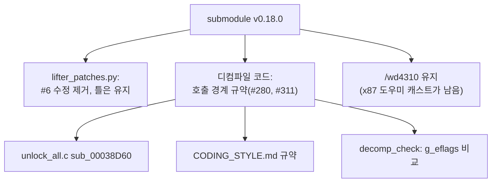

# xboxrecomp upstream v0.18.0 적용 (issue #18)

* 상태: **구현됨**
* 관련 이슈: #18
* 선행 문서: [`docs/design/20261103-i001-project-bootstrap.md`](20261103-i001-project-bootstrap.md) 4절(v0.16.0 고정), [`docs/design/20261104-i006-narrow-products.md`](20261104-i006-narrow-products.md)(lifter 임시 패치)

## 목표

`third_party/xboxrecomp`를 upstream 최신 릴리스 v0.18.0(`37b61d5`, 2026-11-20)에 고정한다. upstream 최신을 따른다는 bootstrap 때의 사용자 지시에 따른 것이다.

## v0.16.0 → v0.18.0에서 우리에게 해당하는 것

우리는 xboxrecomp의 파이프라인 도구(disasm, func_id, abi, recomp)와 생성 코드 옆의 `recomp_types.h`만 쓴다. 커널·APU·NV2A·D3D8 변경은 rexbox를 쓰므로 해당하지 않는다.

* **lifter 정확성**(v0.17.0):
  * 호출 너머 플래그(#311): 플래그를 읽는 쪽이 있는 경계에서만 `g_eflags`를 게시한다.
  * 좁은 폭 즉값(#278), `adc`·`sbb`·`neg`·1비트 시프트 뒤의 OF·PF와 좁은 폭 `sub` 비교(#276).
  * 시프트 횟수 5비트 마스크, 좁은 폭 `mul`/`imul`(#277), `fnsave`/`frstor`.
  * CFG가 닿는 블록만 lift(#279).
  * 프레임 포인터를 생략한 함수의 EBP를 호출 너머로 유지(#280).
  * 단독 switch 분기(#310), `wbinvd`(#309).
* **lifter**(v0.18.0): xmm 논리·비교, `fincstp`/`fdecstp`(#329), `fcmov*`의 CF(#314), 표 뒤로 가는 직접 점프(#275), 슬롯 1부터 쓰는 점프 표(#338), seed의 `not_function`(#339, #333), recomp 단계 34~39% 단축(#336).
* **disasm**: 디코더 캐시로 5.6배 빠름(#255), 패딩 뒤 탐색이 alias 본문을 자르지 않음(#262).

## 결정

1. **lifter 임시 패치**: #6의 좁은 폭 `mul`/`imul` 수정은 upstream #277과 같으므로 지운다. 패치 메커니즘(`lifter_patches.py`, `lifter.py`의 `patched` 경로, `test_lifter_patches.py`)은 다음 lifter 결함에 대비해 남긴다(사용자 결정). 테스트는 그 형태를 계속 컴파일해 x86 규칙과 비교한다(upstream 회귀 감시).
2. **디컴파일 코드의 호출 경계 규약**: v0.17.0부터 lift된 코드는 다른 함수를 부르기 직전과 `ret`에서 `g_ebp`·`g_seh_ebp`에 현재 EBP를 쓰고, 호출 뒤 플래그를 읽는 호출자가 있으면 `ret`에서 `g_eflags`를 쓴다. 손으로 쓴 함수도 같은 규약을 지켜야 한다.
   * `sub_00038D60`(issue #13, 모드 메뉴)은 lift 본문과 달라졌다(`ebp`, `g_seh_ebp`, 스택 한 칸). 호출 전 EBP 게시, `ret`의 EBP 게시, `ret`의 플래그(마지막 `cmp edi, 0xB`, `edi == 11`: ZF·PF 1, CF·SF·OF 0)를 넣는다. 호출자 `0x0002774A`, `0x0002775F`가 호출 뒤 CF를 읽는다.
   * `sub_000278A0`, `sub_00033340`, `sub_00075F10`은 lift 본문을 감싸고 그 뒤에 다른 함수를 부르거나 세 값을 바꾸지 않으므로 그대로다. `sub_0016F12A`, `sub_00087E12`(호스트 어댑터)의 호출자는 플래그를 읽지 않는다.
   * `docs/CODING_STYLE.md`에 규약을 적고, `reexceed_decomp_check`가 `g_eflags`도 비교하게 한다(초기값은 산술 플래그를 모두 켠 `0x00000ED7`).
3. **`/wd4310`**: v0.18.0의 `recomp_types.h`에도 상수를 잘라 캐스트하는 x87 도우미가 남아 있어(빼고 빌드하면 C4310 5건) 유지한다.

## 검증 전략

1. `test_lifter_patches.py`: 패치가 건드리지 않는 형태가 upstream과 같은지, 좁은 폭 곱셈이 x86과 같은지.
2. 다시 lift해 v0.16.0과 통계(함수 수, 실패, 미해결 대상, 미구현 명령)를 비교한다.
3. Win32 x86 Release·Debug 빌드(경고·오류 0), CTest 7/7, `reexceed_decomp_check` 일치. `g_eflags` 비교가 차이를 잡는지 디컴파일 코드의 플래그를 일부러 틀리게 해 확인한다.
4. 실행해 타이틀 화면까지 가는지 본다. 선곡·게임플레이는 사용자가 확인한다.

---

# Moving to xboxrecomp upstream v0.18.0 (issue #18)

* Status: **implemented**
* Related issue: #18
* Preceding documents: [`docs/design/20261103-i001-project-bootstrap.md`](20261103-i001-project-bootstrap.md) section 4 (the v0.16.0 pin), [`docs/design/20261104-i006-narrow-products.md`](20261104-i006-narrow-products.md) (the temporary lifter patch)

## Goal

Pin `third_party/xboxrecomp` to upstream's latest release, v0.18.0 (`37b61d5`, 2026-11-20), following the user's bootstrap instruction to track upstream's latest.

## What concerns us from v0.16.0 to v0.18.0

We use only xboxrecomp's pipeline tools (disasm, func_id, abi, recomp) and the `recomp_types.h` next to the generated code. Kernel, APU, NV2A and D3D8 changes do not apply, since we run on rexbox.

* **Lifter correctness** (v0.17.0):
  * Flags across calls (#311): `g_eflags` is published only at boundaries whose far side reads the flags.
  * Narrow immediates (#278); OF and PF after `adc`, `sbb`, `neg` and shifts by one, and narrow `sub` compares (#276).
  * Shift counts masked to 5 bits, narrow `mul`/`imul` (#277), `fnsave`/`frstor`.
  * Only CFG-reachable blocks are lifted (#279).
  * Frame-pointer-omitted EBP survives a call (#280).
  * A lone switch arm (#310), `wbinvd` (#309).
* **Lifter** (v0.18.0): xmm logic and compares, `fincstp`/`fdecstp` (#329), CF for `fcmov*` (#314), direct jumps past an inline table (#275), jump tables indexed from slot 1 (#338), `not_function` seeds (#339, #333), a 34-39% faster recomp step (#336).
* **Disasm**: 5.6x faster with a cached decoder (#255); the past-padding sweep leaves alias bodies whole (#262).

## Decisions

1. **The temporary lifter patch**: #6's narrow `mul`/`imul` fix is what upstream #277 does, so it is removed. The mechanism (`lifter_patches.py`, `lifter.py`'s `patched` path, `test_lifter_patches.py`) stays for the next lifter defect (the user's decision). The test keeps compiling those forms and comparing them with x86 (a guard against an upstream regression).
2. **The call-boundary convention for decompiled code**: from v0.17.0, lifted code writes the current EBP to `g_ebp` and `g_seh_ebp` right before calling another function and at `ret`, and writes `g_eflags` at `ret` when a caller reads flags after the call. Hand-written functions must keep the same convention.
   * `sub_00038D60` (issue #13, the mode menu) no longer matched its lifted body (`ebp`, `g_seh_ebp`, one stack slot). It gets the EBP publish before each call, at `ret`, and the flags at `ret` (from the last `cmp edi, 0xB`, `edi == 11`: ZF and PF set, CF, SF and OF clear). Its callers at `0x0002774A` and `0x0002775F` read CF after the call.
   * `sub_000278A0`, `sub_00033340` and `sub_00075F10` wrap the lifted body and call nothing and change none of the three after it, so they stay. The callers of `sub_0016F12A` and `sub_00087E12` (host adapters) read no flags.
   * `docs/CODING_STYLE.md` records the convention, and `reexceed_decomp_check` compares `g_eflags` too (starting at `0x00000ED7`, every arithmetic flag set).
3. **`/wd4310`**: v0.18.0's `recomp_types.h` still has x87 helpers with truncating constant casts (five C4310 warnings without it), so it stays.

## Verification

1. `test_lifter_patches.py`: the forms no patch targets lift as upstream emits them, and the narrow products match x86.
2. Lift again and compare the statistics (functions, failures, unresolved targets, unimplemented instructions) with v0.16.0.
3. Win32 x86 Release and Debug builds (no warnings or errors), CTest 7/7, `reexceed_decomp_check` matching; check that the `g_eflags` comparison catches a difference by breaking the decompiled flags on purpose.
4. Run it to the title screen. Song select and gameplay are for the user to check.
