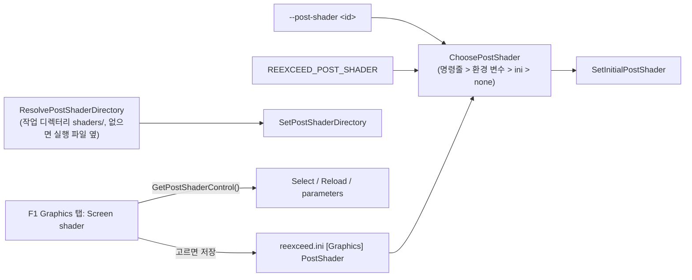

# 화면 셰이더 설정 (issue #20)

* 상태: **구현됨** (`91d05d9`)
* 관련 이슈: #20, rexbox #91(기능 자체)
* 참고: reexec/reDMP1 v0.0.25(#49, 커밋 `b328e9a`): `src/app/main.cpp`, `settings.{h,cpp}`, `settings_ui.{h,cpp}`, `settings_probe.cpp`

## 목표

reDMP1과 같이, rexbox의 표시 단계 화면 셰이더(rexbox #91, `include/rexbox/hle/d3d8/d3d8_post_shader.h`)를 reEXCEED의 설정에 연결한다. 셰이더는 표시 단계에서만 적용되며 게임 로직과 게스트 메모리에는 영향이 없다.

## 설계

* **`reexceed.ini`**: `[Graphics]`에 `PostShader = none`. 메뉴에서 고르면 저장한다. 매개변수 값은 저장하지 않는다(reDMP1, re2DJ와 같음).
* **명령줄과 환경 변수**: `--post-shader <id>`, `--post-shader=<id>`, `REEXCEED_POST_SHADER`.
  * 우선순위는 명령줄 > 환경 변수 > ini > `none`.
  * 명령줄이나 환경 변수로 정한 값은 ini에 쓰지 않는다.
  * 값이 없거나 빈 `--post-shader`는 사용법 오류다.
  * 사용법 출력(`main.cpp`의 `Usage:` 줄)에 넣는다.
* **셰이더 디렉터리**: `ResolvePostShaderDirectory(실행 파일 디렉터리)`. 시작 로그에 `[app] post shader: <id> (directory <경로>)`를 남긴다.
* **F1 Graphics 탭**: 이미지 품질(Image quality) 근처에 `Screen shader` 구역을 둔다. 구성은 reDMP1 `DrawPostShaderMenu`와 같다.
  * 콤보(`none`과 목록), Reload 버튼, 셰이더 디렉터리 표시.
  * 오류는 빨간 글씨로 보인다.
  * 매개변수 슬라이더(값, 최소, 최대, 단계)와 기본값 되돌리기.
  * `GetPostShaderControl()`이 null이면 비활성으로 두고 이유를 한 줄 보인다.
  * 메뉴는 오버레이 빌더 안에서 그려지므로 제어 객체를 바로 부른다(rexbox #91 설계 6절).
* reEXCEED는 GL 문맥 없는 렌더러가 없으므로, null은 장치가 아직 없을 때뿐이다.

## 검증 전략

1. 설정 파일 읽기·쓰기와 우선순위(명령줄·환경 변수·파일)를 확인한다. 앱 smoke 시험 방식에 맞추거나, reDMP1 `settings_probe.cpp`처럼 작은 검사를 CTest에 둔다.
2. Win32 x86 Release·Debug 경고 0, CTest 통과.
3. 창에서 확인(사용자 포함):
   * 각 내장 셰이더와 `none`, 메뉴에서 바꾸면 바로 바뀌는지.
   * 슬라이더, Reload, 사용자 `.glsl`/`.glslp`, 깨진 파일의 오류 표시.
   * 다시 실행하면 유지되는지, `--post-shader`가 우선하는지.
   * 화면비 4:3·16:9, 렌더 배율 1·2, 원본 크기 출력(#14) 켬·끔에서 그림이 맞는지.

---

# Screen Shader Setting (issue #20)

* Status: **implemented** (`91d05d9`)
* Related issues: #20, rexbox #91 (the feature itself)
* Reference: reexec/reDMP1 v0.0.25 (#49, commit `b328e9a`): `src/app/main.cpp`, `settings.{h,cpp}`, `settings_ui.{h,cpp}`, `settings_probe.cpp`

## Goal

Connect rexbox's presentation screen shaders (rexbox #91, `include/rexbox/hle/d3d8/d3d8_post_shader.h`) to reEXCEED's settings, as reDMP1 does. Shaders apply at presentation only and do not touch game logic or guest memory.

## Design

* **`reexceed.ini`**: `PostShader = none` in `[Graphics]`, saved when chosen in the menu. Parameter values are not saved (as in reDMP1 and re2DJ).
* **Command line and environment**: `--post-shader <id>`, `--post-shader=<id>` and `REEXCEED_POST_SHADER`.
  * Precedence: command line > environment > ini > `none`.
  * A value set by the command line or environment is not written to the ini.
  * A missing or empty `--post-shader` value is a usage error.
  * The usage text (`Usage:` in `main.cpp`) lists the option.
* **Shader directory**: `ResolvePostShaderDirectory(executable directory)`. The start log says `[app] post shader: <id> (directory <path>)`.
* **F1 Graphics tab**: a `Screen shader` section near Image quality, built like reDMP1's `DrawPostShaderMenu`:
  * a combo (`none` and the list), a Reload button and the shader directory;
  * an error in red;
  * parameter sliders (value, minimum, maximum, step) and a reset to defaults;
  * when `GetPostShaderControl()` is null, the section is disabled with a one-line reason.
  * The menu is drawn inside the overlay builder, so it calls the control object directly (rexbox #91 design section 6).
* reEXCEED has no renderer without a GL context, so null only means the device does not exist yet.

## Verification

1. Check reading and writing the settings and the precedence (command line, environment, file), in the app smoke tests' style or as a small CTest check like reDMP1's `settings_probe.cpp`.
2. Win32 x86 Release and Debug with 0 warnings, CTest passing.
3. In the window (including the user's check):
   * each built-in and `none`, and that a menu change shows at once;
   * the sliders, Reload, a user `.glsl`/`.glslp`, and the error of a broken file;
   * that the choice survives a restart and that `--post-shader` wins;
   * that the picture is right at 4:3 and 16:9, render scale 1 and 2, and full-size picture (#14) on and off.
