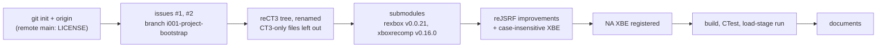

# 작업 로그: 프로젝트 부트스트랩 (issue #1)

설계: [20261103-i001](../design/20261103-i001-project-bootstrap.md) · 작업 지시: [20261103-i001](../work-orders/20261103-i001-project-bootstrap.md)

## 한 일

* 저장소: `git init -b main`, `origin` = `git@github.com:reexec/reEXCEED.git`. 원격 `main`(`e0c631e`, MIT `LICENSE`)을 받고 작업 브랜치 `i001-project-bootstrap`을 만들었다. issue #1, #2를 만들었다.
* 트리: reCT3 `v0.0.20`(`0e211f9`)의 파일을 이름만 바꿔 가져왔다. 가져오지 않은 것: `decomp/{d3dx_matrix,adxm_lock,sj_lock}.c`, `scripts/drive_west_coast.ps1`, `docs/guides/driving-measurement.md`, `docs/analysis/{cri-middleware,d3dx-matrix}.md`, 이력 문서 전부.
* submodule: rexbox `v0.0.21`(`bc21519`), xboxrecomp upstream `v0.16.0`(`f0f8a46`). 작업 중 사용자가 "xboxrecomp는 upstream 최신 버전"을 지시해 v0.15.0 대신 v0.16.0으로 했다. `templates/` 아래 차이가 0줄이고(ABI 헤더 같음), `tools/recomp/lifter.py`의 차이는 16비트 push/pop뿐임을 확인했다.
* 타이틀 계층: `register_xbe.py`로 북미판을 등록했다(`exceed_us` md5 `575f861eb700e86a82c0ad530dc4a310`; 인증서 `{"North America", 0x41440002, 0x42F8EC5C, 0x00000001, 0x42EDCD9F}`). XDK 내부 주소(`kXdkInternals`)는 0개, 시드와 추가 심볼은 비웠다. `decomp_check`는 CT3의 D3DX 경우 세 묶음을 빼고 틀(`Suites()`가 빈 목록)만 남겼다.
* reJSRF에서: `build_stamp.cmake`(rexbox 버전·커밋), Info 탭 `rexbox`, `rexbox commit` 행, Stats 그래프 높이 64 → 32, `EnableStubLogInDebug`(게스트 진입 직전).
* Exceed 보강: 앱의 `FindXbe`, 스크립트의 `lifter.find_case_insensitive`(`regenerate.py`, `register_xbe.py`, `find_pointer_targets.py`의 기본 XBE).
* 문서: README, ARCHITECTURE, AGENTS(출처에 reCT3 추가, 프로젝트 개요), PROJECT_CHARTER, CODING_STYLE, XBE_DESIGN, 분석 개요(신규), 색인, 가이드, CREDITS, THIRD_PARTY_NOTICES. `VERSION` `0.0.1`.

## 문제와 처리

* 첫 Debug 빌드가 `main.cpp(95): error C2001`로 실패했다. 셸 heredoc으로 넣은 문자열의 `\n`이 실제 줄바꿈이 되었다. 고친 뒤로 편집은 파일로 쓴 스크립트나 Edit 도구로 했다.
* 같은 이유로 `docs/kb/README.md`의 백틱 부분이 비었던 것을 바로잡았다.
* Linux에서 재컴파일 코드 없는 실행이 종료 때 segfault: 아래 "Linux" 절. 앱의 두 "로드 뒤 멈춤" 경로를 `std::_Exit(0)`으로 바꿨다.
* reCT3에서 복사된 `VERSION`(`0.0.20`)을 `0.0.1`로 되돌렸다.

## 검증

| 검증 | 결과 |
|---|---|
| Win32 x86 Debug 빌드(Visual Studio 2026, CMake 4.3.1) | 성공, 경고 0 |
| Win32 x86 Release 빌드 | 성공, 경고 0 |
| CTest Debug / Release | 6/6 / 6/6 |
| rexbox probe 직접 실행(Debug) | recomp 8, kernel 94, dsound 73, d3d8 223 검사, 실패 0 |
| `reexceed.exe roms`(Debug, `REXBOX_DISPLAY=none`) | `xbe: North America (default.xbe)`(디스크의 `DEFAULT.XBE`를 찾음), `guest memory: 128 MiB, 19 sections placed, 120172 KiB free`, `hle: 317 exports, kernel imports 104/146 bound, 0 title bindings`, HLE 없는 커널 import 42개 목록, `this build has no recompiled code ...; stopping after load`, 종료 코드 0 |
| `register_xbe.py` | 위 신원 출력, `variants.json` 갱신 |
| Linux x64·x86 Release (WSL2 Ubuntu 24.04) | 빌드 성공, CTest 6/6, 앱 로드 단계까지 종료 코드 0(아래 "Linux" 절) |
| `git status` | `roms/`, `build/` 미추적(gitignore) |

### Linux

WSL2 Ubuntu 24.04(GCC 13, CMake 3.28, Ninja), 트리는 `REEXCEED_BUILD_DIR=~/reexceed-build`:

* `scripts/build_linux.sh x64 release`, `x86 release`: 둘 다 빌드 성공, CTest 6/6. SDL의 wayland-scanner가 프로토콜 XML에 `validity error`를 출력하지만 빌드 오류가 아니다.
* `reexceed /mnt/e/.../roms`: 처음에는 로드 단계 출력 뒤 **segfault**로 끝났다(파일로 보낸 stdout은 버퍼째 사라짐). `return 0` 뒤 정적 객체 해제 중이었다. 다른 정상 종료 경로처럼 `fflush` 뒤 `std::_Exit(0)`으로 끝내자 x64·x86 모두 `xbe: North America (default.xbe)`(디스크의 `DEFAULT.XBE`를 대소문자 없이 찾음), `kernel imports 104/146 bound`, `stopping after load`, 종료 코드 0이 되었다. Win32는 같은 경로에서 원래 문제가 없었다.
* 원인 추정: HLE 초기화가 띄운 호스트 스레드가 아직 런타임(main의 지역 객체)을 쓰는 중에 해제된다(**추정**, 디버거 없음). reCT3도 같은 코드라 재컴파일 코드 없는 Linux 빌드에서 같을 것으로 본다(**추정**). rexbox 쪽 해제 순서 문제라면 rexbox issue 후보다.

## 남은 일

* 재컴파일 코드 생성과 첫 부팅(다음 issue): `regenerate.py`, 링크, 진입점 실행, 멈춘 지점 기록.
* HLE 없는 커널 import 42개와 XDK 5849 차이: 부팅이 닿을 때 rexbox issue로.
* `tools/d3d8_check`: lift 뒤.

---

# Work log: project bootstrap (issue #1)

Design: [20261103-i001](../design/20261103-i001-project-bootstrap.md) · Work order: [20261103-i001](../work-orders/20261103-i001-project-bootstrap.md)

## Done

The diagram above shows the order.

* Repository: `git init -b main` with `origin` at `git@github.com:reexec/reEXCEED.git`; the remote `main` (`e0c631e`, MIT `LICENSE`) taken and the task branch `i001-project-bootstrap` created; issues #1 and #2 opened.
* Tree: reCT3 `v0.0.20` (`0e211f9`) brought over under the new names, without `decomp/{d3dx_matrix,adxm_lock,sj_lock}.c`, `scripts/drive_west_coast.ps1`, `docs/guides/driving-measurement.md`, `docs/analysis/{cri-middleware,d3dx-matrix}.md` and all history documents.
* Submodules: rexbox `v0.0.21` (`bc21519`) and upstream xboxrecomp `v0.16.0` (`f0f8a46`); during the work the user asked for upstream's latest xboxrecomp, so v0.16.0 replaced v0.15.0. The difference under `templates/` is zero lines (the ABI header is the same), and `tools/recomp/lifter.py` differs only in 16-bit push/pop.
* Title layer: the North America build registered with `register_xbe.py` (`exceed_us` md5 `575f861eb700e86a82c0ad530dc4a310`; certificate `{"North America", 0x41440002, 0x42F8EC5C, 0x00000001, 0x42EDCD9F}`); no XDK internals (`kXdkInternals` is empty), empty seeds and extra symbols; `decomp_check` without CT3's three D3DX suites, keeping the framework (`Suites()` returns an empty list).
* From reJSRF: `build_stamp.cmake` (rexbox version and commit), the Info tab's `rexbox` and `rexbox commit` rows, the Stats graph height from 64 to 32, `EnableStubLogInDebug` (just before the guest starts).
* For Exceed: `FindXbe` in the app and `lifter.find_case_insensitive` in the scripts (the default XBE of `regenerate.py`, `register_xbe.py` and `find_pointer_targets.py`).
* Documents: README, ARCHITECTURE, AGENTS (reCT3 added as a source, the overview), PROJECT_CHARTER, CODING_STYLE, XBE_DESIGN, the analysis overview (new), the indexes, guides, CREDITS and THIRD_PARTY_NOTICES; `VERSION` `0.0.1`.

## Problems

* The first Debug build failed with `main.cpp(95): error C2001`: a `\n` in a string written through a shell heredoc became a real newline. After the fix, edits went through script files or the Edit tool.
* For the same reason the backticked part of `docs/kb/README.md` came out empty; fixed.
* On Linux, the run without recompiled code ended in a segfault after the load stage, while static objects were destroyed after `return 0` (stdout sent to a file was lost with its buffer). Ending with `fflush` and `std::_Exit(0)`, as every other exit after the HLE is up does, fixed it on x64 and x86; Win32 had no problem on that path. The cause is inferred (no debugger): host threads the HLE started still use the runtime (main's locals) while it is torn down. reCT3 has the same code and likely the same behavior (**inferred**); if the teardown order is rexbox's, it is a rexbox issue candidate.
* `VERSION` copied from reCT3 (`0.0.20`) was set back to `0.0.1`.

## Verification

As in the table above: Win32 x86 Debug and Release build with 0 warnings; CTest 6/6 in both; the rexbox probes run by hand report 8, 94, 73 and 223 checks with 0 failures; `reexceed.exe roms` finds the disc's `DEFAULT.XBE`, identifies the North America build, places 19 sections in 128 MiB (120,172 KiB free), binds 104 of 146 kernel imports (317 HLE exports, 0 title bindings), lists the 42 imports without an export, and stops after load with exit code 0; `register_xbe.py` prints the identity and updates `variants.json`; `roms/` and `build/` stay untracked. Linux x64 and x86 Release on WSL2 Ubuntu 24.04 (GCC 13, CMake 3.28, Ninja): both build, CTest 6/6, and the app finds `DEFAULT.XBE` ignoring case, identifies the North America build, binds 104 of 146 kernel imports and stops after load with exit code 0 (after the fix above). SDL's wayland-scanner prints `validity error` lines for protocol XML; they are not build errors.

## Left open

* Generating the recompiled code and the first boot (the next issue).
* The 42 kernel imports without HLE and the XDK 5849 differences: rexbox issues, when the boot reaches them.
* `tools/d3d8_check`: after the lift.
