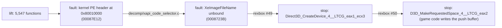

# 작업 로그: 북미판 lift와 첫 부팅 — 진행 중 (issue #4)

설계: [20261103-i004](../design/20261103-i004-first-run.md) · 작업 지시: [20261103-i004](../work-orders/20261103-i004-first-run.md) · 분석: [exceed-xbe-overview §6~§9](../analysis/exceed-xbe-overview.md)

## 한 일 (1차 세션)

1. `regenerate.py`(xboxrecomp v0.16.0): 함수 5,547개, 실패 0, C 약 104만 줄(23파일), 미해결 호출 대상 3개, 미구현 명령 74개. XDK 심볼 361개, HLE override 268개, XDK 변수 44개. lift 시간 약 10분(disasm 503초).
2. Win32 x86 Debug 빌드(생성 코드 포함): 오류 0.
3. **frontier 1** — 스레드 2가 게스트 RAM 밖 `7509EE66`을 읽고 fault. 맵·PDB(`llvm-symbolizer`)와 정지 시 RAM 덤프(`REXBOX_STOP_DUMP`)의 스택으로 추적했다. `mainXapiStartup` → `00087E76` → tail jump `00087E12`가 커널 PE 헤더(`0x8001003C`)를 읽어 GDT 코드 셀렉터의 한계를 줄이는 코드였다. 물리 메모리 창 때문에 타이틀의 XBE 헤더를 읽었다. → `src/game/exceed/decomp/xapi_code_selector.c`(아무것도 하지 않는 어댑터).
4. **frontier 2** — `eax = FE000518`(바인딩 안 된 import 326의 합성 VA). XAPI가 `XeImageFileName`을 읽어 D: 대상과 비교한다. → rexbox [#49](https://github.com/reexec/rexbox/issues/49): 데이터 export `XeImageFileName` = `\Device\CdRom0\<XBE 파일 이름>`, `KernelConfig::image_file_name`. 앱이 디스크에서 찾은 파일 이름(`DEFAULT.XBE`)을 넘긴다.
5. 그 뒤 진행: T:, U: 링크, 세이브 메타 파일, Z: 캐시 파티션 포맷, `Z:\AUDIO`, `BGA`, `TITLE`, `STEP` 디렉터리 생성, `t:\$u\contentmeta.xbx`(없음, `C000003A`).
6. **frontier 3** — `Direct3D_CreateDevice_4__LTCG_eax1_ecx3`. lift 본문으로 대응을 확인했다(eax = BehaviorFlags, 스택 = pPresentationParameters, ecx = ppDevice, `ret 4`). → rexbox [#50](https://github.com/reexec/rexbox/issues/50): `HleCall::Eax/Ebx/Esi/Edi`, `CreateDevice` 핵심 함수와 변형 export. 디바이스: 640x480, 포맷 `07`, 백 버퍼 2, 멀티샘플 `0011`, 깊이 `2A`, behavior `0x40`.
7. **frontier 4(현재)** — `D3D_MakeRequestedSpace_4__LTCG_eax2`(`00179470`). 단순 변형이 아니다: 게임 코드(`000765E0` 등 7개 함수)가 디바이스의 푸시 버퍼 포인터(`[0x185A88]` → 디바이스 → `pPut`)에 NV2A 메서드(`0x0004030C`, `0x00041D78` …)를 직접 쓰고, 모자라면 이것을 부른다(분석 §9). rexbox에 디바이스 푸시 버퍼 해석 설계가 필요하다 — **사용자 결정 대기**.

## 한 일 (1차 세션, 이어서: 디바이스 푸시 버퍼부터)

8. 사용자 결정: rexbox가 디바이스 푸시 버퍼를 해석한다. → rexbox [#51](https://github.com/reexec/rexbox/issues/51): HLE 디바이스에 게스트 푸시 버퍼(512 KiB, `+0` pPut, `+4` 한계, `+0x24`/`+0x28` 시작·끝), `MakeRequestedSpace`/`KickOff`/`Clear`/`Swap`/`Draw*`에서 flush해 기존 해석기로 읽는다. 같은 작업에서 #50의 표 기반 어댑터로 공개 서명을 유지하는 LTCG 변형 12개(`SetTransform`, `SetStreamSource`, `Swap` …)를 공개 export로 다시 framing한다.
9. **첫 프레임 present**(LTCG `Swap`). 이어서 `DirectSoundCreate`, `XInitDevices`(게임패드 포트 1). 해석하지 않은 푸시 버퍼 메서드: `030C`, `1D78`.
10. 커널 import(rexbox [#52](https://github.com/reexec/rexbox/issues/52)): `KeQueryPerformanceCounter`/`Frequency`(3.375 MHz), `XcHMAC`(HMAC-SHA1), `MmQueryStatistics`, `XcRC4Key`/`XcRC4Crypt`. kernel probe 103 검사.
11. `KeInitializeInterrupt vector 52` 뒤 NIC MMIO(`0xFEF00110`) 쓰기 fault: 게임의 네트워크 초기화(`00080E70`)는 `XNetStartup`이 실패하면 오프라인 경로를 탄다. → rexbox [#53](https://github.com/reexec/rexbox/issues/53): `XNetStartup` = `WSAENETDOWN`, `XNetGetEthernetLinkStatus` = 0. `hle_libraries.json`이 두 함수를 고른다(override 270개).
12. DSOUND `DirectSoundCreateStream`(`000EBD9E`): rexbox DSOUND에 스트림이 없었다. → rexbox [#54](https://github.com/reexec/rexbox/issues/54): XMediaObject vtable(타이틀의 `0x00190470`과 같은 순서, 합성 주소 `0xFD000000`~), 패킷 큐, 믹싱, `DirectSoundDoWork`에서 완료 전달. 스트림 `2 ch, 44100 Hz, 16 bit, 43 packets, callback 0007E9C0`이 만들어진다.
13. D3D8 `D3DDevice_CreateStateBlock`: 상태 블록은 라이브러리의 렌더·텍스처 상태 전역을 캡처하고, 식별되지 않은 Apply(`00174BED`, lift)가 공개 setter로 되돌린다. → `hle_libraries.json`의 `lifted`에 `D3DDevice_CreateStateBlock`, `D3D_ClearStateBlockFlags`(**추정**: HLE 디바이스가 0으로 둔 내부 필드는 0으로 캡처된다).
14. XACT(`0016F12A`)가 APU 전역 샘플 카운터 레지스터 `0xFE80200C`를 직접 읽어 fault(분석 §11). → rexbox [#55](https://github.com/reexec/rexbox/issues/55) `rexbox_dsound_apu_sample_count()`, `decomp/xact_sample_clock.c`(같은 결과, 레지스터 대신 호스트 훅 `reexceed_host_apu_sample_count`, IRQL 올림은 생략).
15. DSOUND `XAudioCreatePcmFormat`(WAVEFORMATEX만 채운다) → `lifted`에 `XAudioCreatePcmFormat`, `XAudioCreateAdpcmFormat`. 게임이 직접 부르는데 rexbox에 없는 HLE 대상은 27개 남았다(D3D getter 13, `EnableOverlay`, `PersistDisplay`, `SetRenderState_SampleAlpha`, `SetVertexDataColor`, `SetVertexShaderConstantNotInline`, `D3D_DestroyResource_0__LTCG_edi1`, `D3D_UpdateProjectionViewportTransform`, DSOUND 3D 계산기·보이스 속성·`SetPlayRegion`·`SetOutputBuffer`·`SynchPlayback` 등).
16. 그 27개를 한 번에: rexbox [#56](https://github.com/reexec/rexbox/issues/56)(D3D 조회 13, 정점 상수 fastcall, DSOUND 보이스 함수, 받기만 하는 설정). `SetVertexDataColor`(푸시 버퍼만 쓴다)와 3D 계산기 4개는 `lifted`.
17. `D3DDevice_SetVertexShaderConstant1`과 그 뒤: 인라인 코드가 정적 디바이스 `0x001835E0`을 직접 써서 푸시 버퍼에 쓴다. → 프로파일 `kXdkInternals`에 `D3D_g_Device` = `0x001835E0`, rexbox #56이 바인딩된 정적 디바이스를 HLE 디바이스로 쓴다.
18. **현재** — 프레임 58장이 60 fps 간격으로 present되고, 게임 스레드 3·4가 생기며, XInput 패드가 열린다(`XInputOpen(gamepad, port 0)`). 그 뒤 스레드 3이 lift된 코드에서 10초 넘게 HLE를 부르지 않고(마지막 `Swap` 뒤), 스레드 2가 그 스레드가 가진 임계 구역 `0x008433AC`를 기다린다. 함께 보고되는 것: `DrawVerticesUP: vertex format 00000000`, SDL Debug 단언(`SDL_PumpEvents`가 메인 스레드가 아닌 곳에서), 푸시 버퍼 메서드 `030C`/`1D78`, `no D3D_InitializeDeviceState binding`.

19. Release 빌드로 진단: Debug의 정체는 SDL Debug 단언(패드 연결 때 게스트 스레드에서 `SDL_PumpEvents`, 종료 코드 3 = `abort`)으로 프로세스가 끝난 것이었다. rexbox 후속 issue 후보. Release에서는 60초 넘게 돈다.
20. `Lock2DSurface_16__LTCG_esi4_eax5`(rexbox #56에 추가), 스트림 메서드 합성 주소를 `0xFF000000`으로(rexbox #54 수정: lifter의 간접 호출 검사가 `0xFD000000`을 "outside code"로 건너뛰었다).
21. 프로파일 `kXdkInternals`에 `D3D_InitializeDeviceState` = `0x0017A1E0`(디바이스 초기화 `0x0017A3D0`이 부르는 기본 상태 루틴: 항등 변환, `0x001825E4`의 렌더 상태 기본값 표).
22. 검은 화면 추적: 프레임 캡처의 그리기 상태가 `vs 00000000`, `vp 0,0 0x0`이었다. lift된 ApplyStateBlock(`0x00174BED`)이 lift된 CreateStateBlock이 캡처한 0(HLE 디바이스가 채우지 않는 내부 필드)을 되돌렸다. → rexbox [#57](https://github.com/reexec/rexbox/issues/57) 상태 블록 HLE, `xdk_symbols_extra.json`에 `D3DDevice_ApplyStateBlock` = `0x00174BED`, `CreateStateBlock`은 `lifted`에서 뺀다. 이제 `vs 00000152`, `vp 0,0 640x480`.
23. **현재** — 60초 동안 3400프레임 넘게 돌지만 화면은 검다. 이 시점은 로딩 단계다(`TITLE\LOADING.PNZ`, 글꼴 `*.xpr`, UIX 뱅크를 읽고 `BGA\*.DAT`를 Z: 캐시로 복사). 캡처된 그리기는 검은 페이드 사각형(정점 색 `FF000000`, 텍스처 없음, 화면 왼쪽 밖)과 높이 0인 텍스처 사각형(로딩 막대의 시작으로 **추정**)뿐이다. 로딩 그림이 어떤 경로로 그려지는지가 다음 질문이다.

24. 화면 추적(이어서): 게임은 로딩에 갇히지 않는다. Z: 캐시에 `ESRB.DAT`, `81.DAT`, `82_EN.DAT`, `ML.DAT` 등이 차례로 생긴다. 프레임 1500 캡처에서 **#1이 화면 전체 크기의 텍스처 사각형**이고 텍스처 형식이 `0x24`(YUY2, 선형 640x480)다. 나머지는 화면 밖 테두리의 검은 사각형이다. 게스트 메모리의 그 텍스처에는 실제 YUY2 값이 있다(XMV 디코딩이 된다). → rexbox [#58](https://github.com/reexec/rexbox/issues/58): YUY2/UYVY 디코드, 캡처에 view·world 출력.
25. **현재** — 여전히 검다. 캡처의 `owner` 그림이 전부 0이라 어느 그리기도 픽셀을 쓰지 못한다. 정점은 FVF `0x152`(XYZ, 법선, 색, 텍스처 1)로 읽히고, 위치는 픽셀 좌표(−0.5~639.5 × −0.5~479.5, v 좌표는 아래에서 위로)다. view·world는 항등, projection은 768×576 정사영 모양(`1/384`, `1/288`, x·y 이동 없음)이라 화면에 맞지 않는다. 행렬이나 정점 해석의 어딘가가 원본과 다르다(**미확정**). 푸시 버퍼에서 해석하지 않은 메서드는 12개(`030C`, `0394`, `0398`, `0A20`~`0A2C`(뷰포트 오프셋 0.53125), `1B0C`/`1B4C`/`1B8C`/`1BCC`, `1D78`)이고, 행렬 메서드는 없다.

## submodule

* `third_party/rexbox`: rexbox 작업 브랜치 `i049-xe-image-file-name`의 `84fbd7f`(#49 `3748866`, #50 `f49d055`·`b1d9cd4`, #51 `b1d9cd4`, #52 `8c250fc`, #53 `616ff96`, #54 `f3e00e2`, #55 `3a16fb2`, #56 `9a8f164`, #57 `b1cbfcd`, #58 `84fbd7f`). **임시 고정**이며 아직 push하지 않았다. rexbox에서 머지되면 태그로 옮긴다.

## 검증

| 검증 | 결과 |
|---|---|
| Win32 x86 Debug(생성 코드, rexbox `f49d055`) | 오류 0, 경고 0 |
| CTest Debug | 7/7(probe 4, smoke 2, `reexceed_decomp_check` 경우 0) |
| `rexbox_kernel_probe` | 97 검사, 실패 0 |
| `reexceed.exe roms`(hidden, no audio) | 위 frontier 4에서 멈춤(종료 코드 3) |

## 다음

* 디바이스 푸시 버퍼 해석의 방향을 정한 뒤 rexbox에서 설계·구현.
* 프로파일: 5849의 `D3D_InitializeDeviceState`(로그: `no D3D_InitializeDeviceState binding`)를 lift 본문에서 찾아 `kXdkInternals`에 둔다.

---

# Work log: lifting the North America build and the first boot — in progress (issue #4)

Design: [20261103-i004](../design/20261103-i004-first-run.md) · Work order: [20261103-i004](../work-orders/20261103-i004-first-run.md) · Analysis: [exceed-xbe-overview §6–§9](../analysis/exceed-xbe-overview.md)

## Done (first session)

The diagram above shows the frontiers. 1) `regenerate.py` (xboxrecomp v0.16.0) lifts 5,547 functions with no failures (about 1.04 million lines of C in 23 files, 3 unresolved call targets, 74 unimplemented instructions; 361 XDK symbols, 268 HLE overrides, 44 XDK variables; about 10 minutes, disasm 503 s). 2) The Win32 x86 Debug build with the generated code has no errors. 3) **Frontier 1**: thread 2 faults reading `7509EE66` outside guest RAM; traced with the map, the PDB (`llvm-symbolizer`) and the stack in a stop dump (`REXBOX_STOP_DUMP`) to `mainXapiStartup` → `00087E76` → tail jump `00087E12`, which reads the kernel's PE header (`0x8001003C`) to narrow the GDT code selector's limit and, through the physical window, read the title's own XBE header; replaced by the do-nothing adapter `src/game/exceed/decomp/xapi_code_selector.c`. 4) **Frontier 2**: `eax = FE000518`, the synthetic VA of the unbound import 326: XAPI reads `XeImageFileName` to compare with the D: target; rexbox [#49](https://github.com/reexec/rexbox/issues/49) adds the data export (`\Device\CdRom0\<XBE file name>`, `KernelConfig::image_file_name`), and the app passes the file name found on the disc (`DEFAULT.XBE`). 5) The start-up then links T: and U:, reads the save metadata, formats the Z: cache partition, creates `Z:\AUDIO`, `BGA`, `TITLE` and `STEP`, and looks for `t:\$u\contentmeta.xbx` (absent, `C000003A`). 6) **Frontier 3**: `Direct3D_CreateDevice_4__LTCG_eax1_ecx3`, mapped from its lifted body (eax = BehaviorFlags, stack = pPresentationParameters, ecx = ppDevice, `ret 4`); rexbox [#50](https://github.com/reexec/rexbox/issues/50) adds `HleCall::Eax/Ebx/Esi/Edi`, the `CreateDevice` core and the variant; the device is 640x480, format `07`, two back buffers, multisample `0011`, depth `2A`, behavior `0x40`. 7) **Frontier 4 (current)**: `D3D_MakeRequestedSpace_4__LTCG_eax2` (`00179470`) is no plain variant: game code (`000765E0` and six more functions) writes NV2A methods (`0x0004030C`, `0x00041D78`, ...) straight into the device push buffer (`[0x185A88]` → the device → `pPut`) and calls it when room runs out (analysis §9). rexbox needs a design for interpreting the device push buffer — **waiting for the user's decision**.

## Done (first session, continued: from the device push buffer)

8) The user's decision: rexbox interprets the device push buffer. rexbox [#51](https://github.com/reexec/rexbox/issues/51) gives the HLE device a guest push buffer (512 KiB; `+0` pPut, `+4` threshold, `+0x24`/`+0x28` base and end) and flushes it through the existing interpreter at `MakeRequestedSpace`, `KickOff`, `Clear`, `Swap` and `Draw*`; with it, #50's table-driven adapter re-frames the twelve LTCG variants that keep the public signature (`SetTransform`, `SetStreamSource`, `Swap`, ...) for the public exports. 9) **The first frame is presented** (the LTCG `Swap`), followed by `DirectSoundCreate` and `XInitDevices` (gamepad port 1); push-buffer methods left uninterpreted: `030C`, `1D78`. 10) Kernel imports (rexbox [#52](https://github.com/reexec/rexbox/issues/52)): `KeQueryPerformanceCounter`/`Frequency` (3.375 MHz), `XcHMAC` (HMAC-SHA1), `MmQueryStatistics`, `XcRC4Key`/`XcRC4Crypt`; the kernel probe has 103 checks. 11) A fault writing the NIC's MMIO (`0xFEF00110`) after `KeInitializeInterrupt vector 52`: the title's network init (`00080E70`) takes an offline path when `XNetStartup` fails, so rexbox [#53](https://github.com/reexec/rexbox/issues/53) returns `WSAENETDOWN` from `XNetStartup` and 0 from `XNetGetEthernetLinkStatus`, both selected in `hle_libraries.json` (270 overrides). 12) DSOUND `DirectSoundCreateStream` (`000EBD9E`): rexbox's DSOUND had no streams; rexbox [#54](https://github.com/reexec/rexbox/issues/54) adds the XMediaObject vtable (in the order of the title's `0x00190470`, synthetic addresses from `0xFD000000`), the packet queue, mixing and completion on `DirectSoundDoWork`, and the stream `2 ch, 44100 Hz, 16 bit, 43 packets, callback 0007E9C0` is created. 13) D3D8 `D3DDevice_CreateStateBlock`: the block captures the library's render- and texture-state globals, and the unidentified Apply (`00174BED`, lifted) replays it through the public setters, so `D3DDevice_CreateStateBlock` and `D3D_ClearStateBlockFlags` join `lifted` (**inferred**: internal device fields the HLE device leaves zero are captured as zero). 14) XACT (`0016F12A`) reads the APU's global sample counter register `0xFE80200C` directly and faults (analysis section 11); rexbox [#55](https://github.com/reexec/rexbox/issues/55) gives `rexbox_dsound_apu_sample_count()`, and `decomp/xact_sample_clock.c` computes the same results from the host hook `reexceed_host_apu_sample_count` in place of the register (the IRQL raise is left out). 15) DSOUND `XAudioCreatePcmFormat`, which only fills a WAVEFORMATEX, so it and `XAudioCreateAdpcmFormat` join `lifted`. 27 HLE targets the title calls directly are still missing in rexbox (13 D3D getters, `EnableOverlay`, `PersistDisplay`, `SetRenderState_SampleAlpha`, `SetVertexDataColor`, `SetVertexShaderConstantNotInline`, `D3D_DestroyResource_0__LTCG_edi1`, `D3D_UpdateProjectionViewportTransform`, and DSOUND's 3D calculator, voice properties, `SetPlayRegion`, `SetOutputBuffer`, `SynchPlayback` and others). 16) Those 27 at once: rexbox [#56](https://github.com/reexec/rexbox/issues/56) (13 D3D queries, the vertex-constant fastcalls, DSOUND voice calls, accepted settings); `SetVertexDataColor` (it only writes the push buffer) and the four 3D-calculator functions join `lifted`. 17) `D3DDevice_SetVertexShaderConstant1` and after: inlined code writes the push buffer through the static device `0x001835E0` directly, so the profile binds `D3D_g_Device` = `0x001835E0` in `kXdkInternals` and rexbox #56 makes a bound static device the HLE device. 18) **Current**: 58 frames are presented at 60 fps intervals, game threads 3 and 4 start and the XInput pad opens (`XInputOpen(gamepad, port 0)`); then thread 3 runs lifted code for over 10 s without an HLE call (after its last `Swap`) while thread 2 waits on the critical section `0x008433AC` it holds. Reported along the way: `DrawVerticesUP: vertex format 00000000`, an SDL Debug assertion (`SDL_PumpEvents` off the main thread), push-buffer methods `030C`/`1D78`, `no D3D_InitializeDeviceState binding`.

19) Diagnosing with the Release build: the Debug stall was the process ending on an SDL Debug assertion (`SDL_PumpEvents` on a guest thread when the pad arrives; exit code 3 = `abort`), a rexbox follow-up candidate; Release runs past 60 s. 20) `Lock2DSurface_16__LTCG_esi4_eax5` (added to rexbox #56), and the stream methods' synthetic addresses moved to `0xFF000000` (a fix to rexbox #54: the lifter's indirect-call check skipped `0xFD000000` as "outside code"). 21) The profile binds `D3D_InitializeDeviceState` = `0x0017A1E0` in `kXdkInternals` (the default-state routine the device init `0x0017A3D0` calls: identity transforms, the render-state default table at `0x001825E4`). 22) Tracing the black picture: a frame capture showed draws with `vs 00000000` and `vp 0,0 0x0`, restored by the lifted ApplyStateBlock (`0x00174BED`) from the zeros the lifted CreateStateBlock captured (internal fields the HLE device does not fill); rexbox [#57](https://github.com/reexec/rexbox/issues/57) makes state blocks HLE, `xdk_symbols_extra.json` names `D3DDevice_ApplyStateBlock` = `0x00174BED`, and `CreateStateBlock` leaves `lifted`; now `vs 00000152`, `vp 0,0 640x480`. 23) **Current**: over 3400 frames in 60 s, still black. This is the loading stage (it reads `TITLE\LOADING.PNZ`, the `*.xpr` fonts and the UIX banks, and copies `BGA\*.DAT` to the Z: cache); the captured draws are black fade quads (vertex color `FF000000`, no texture, left of the screen) and a zero-height textured quad (the start of a loading bar, **inferred**). How the loading picture is drawn is the next question.

24) Tracing the picture (continued): the title is not stuck loading; `ESRB.DAT`, `81.DAT`, `82_EN.DAT`, `ML.DAT` and others appear in the Z: cache one after another. In a frame-1500 capture **draw #1 is a full-screen textured quad** with texture format `0x24` (YUY2, linear 640x480), the rest black quads over the borders outside the screen; that texture holds real YUY2 values in guest memory (XMV decodes). rexbox [#58](https://github.com/reexec/rexbox/issues/58) decodes YUY2/UYVY and prints view and world in captures. 25) **Current**: still black. The capture's `owner` image is all zero, so no draw writes a pixel. The vertices read as FVF `0x152` (XYZ, normal, color, one texture) with pixel-coordinate positions (−0.5..639.5 x −0.5..479.5, v growing upward); view and world are identity and the projection looks like a 768x576 orthographic one (`1/384`, `1/288`, no x or y translation), which does not fit the screen. Something in the matrices or in reading the vertices differs from the original (**unresolved**). Twelve push-buffer methods are left uninterpreted (`030C`, `0394`, `0398`, `0A20`..`0A2C` (viewport offset 0.53125), `1B0C`/`1B4C`/`1B8C`/`1BCC`, `1D78`), none of them matrices.

## Submodule

`third_party/rexbox` is at `84fbd7f` on rexbox's task branch `i049-xe-image-file-name` (#49 `3748866`, #50 `f49d055` and `b1d9cd4`, #51 `b1d9cd4`, #52 `8c250fc`, #53 `616ff96`, #54 `f3e00e2`, #55 `3a16fb2`, #56 `9a8f164`, #57 `b1cbfcd`, #58 `84fbd7f`): a **temporary pin**, not pushed yet, to move to a tag once merged in rexbox.

## Verification

As in the table above: the Win32 x86 Debug build (generated code, rexbox `f49d055`) has 0 errors and 0 warnings; CTest Debug 7/7; `rexbox_kernel_probe` 97 checks, 0 failures; `reexceed.exe roms` (hidden, no audio) stops at frontier 4 (exit code 3).

## Next

Decide the direction for the device push buffer, then design and implement it in rexbox; in the profile, find 5849's `D3D_InitializeDeviceState` (log: `no D3D_InitializeDeviceState binding`) in the lifted library and bind it in `kXdkInternals`.
