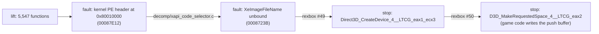

# 작업 로그: 북미판 lift와 첫 부팅 — 진행 중 (issue #4)

설계: [20261103-i004](../design/20261103-i004-first-run.md) · 작업 지시: [20261103-i004](../work-orders/20261103-i004-first-run.md) · 분석: [exceed-xbe-overview §6~§9](../analysis/exceed-xbe-overview.md)

## 한 일 (1차 세션)

1. `regenerate.py`(xboxrecomp v0.16.0): 함수 5,547개, 실패 0, C 약 104만 줄(23파일), 미해결 호출 대상 3개, 미구현 명령 74개. XDK 심볼 361개, HLE override 268개, XDK 변수 44개. lift 시간 약 10분(disasm 503초).
2. Win32 x86 Debug 빌드(생성 코드 포함): 오류 0.
3. **frontier 1** — 스레드 2가 게스트 RAM 밖 `7509EE66`을 읽고 fault. 맵·PDB(`llvm-symbolizer`)와 정지 시 RAM 덤프(`REXBOX_STOP_DUMP`)의 스택으로 추적했다. `mainXapiStartup` → `00087E76` → tail jump `00087E12`가 커널 PE 헤더(`0x8001003C`)를 읽어 GDT 코드 셀렉터의 한계를 줄이는 코드였다. 물리 메모리 창 때문에 타이틀의 XBE 헤더를 읽었다. → `src/game/exceed/decomp/xapi_code_selector.c`(아무것도 하지 않는 어댑터).
4. **frontier 2** — `eax = FE000518`(바인딩 안 된 import 326의 합성 VA). XAPI가 `XeImageFileName`을 읽어 D: 대상과 비교한다. → rexbox [#49](https://github.com/reexec/rexbox/issues/49): 데이터 export `XeImageFileName` = `\Device\CdRom0\<XBE 파일 이름>`, `KernelConfig::image_file_name`. 앱이 디스크에서 찾은 파일 이름(`DEFAULT.XBE`)을 넘긴다.
5. 그 뒤 진행: T:, U: 링크, 세이브 메타 파일, Z: 캐시 파티션 포맷, `Z:\AUDIO`, `BGA`, `TITLE`, `STEP` 디렉터리 생성, `t:\$u\contentmeta.xbx`(없음, `C000003A`).
6. **frontier 3** — `Direct3D_CreateDevice_4__LTCG_eax1_ecx3`. lift 본문으로 대응을 확인했다(eax = BehaviorFlags, 스택 = pPresentationParameters, ecx = ppDevice, `ret 4`). → rexbox [#50](https://github.com/reexec/rexbox/issues/50): `HleCall::Eax/Ebx/Esi/Edi`, `CreateDevice` 핵심 함수와 변형 export. 디바이스: 640x480, 포맷 `07`, 백 버퍼 2, 멀티샘플 `0011`, 깊이 `2A`, behavior `0x40`.
7. **frontier 4(현재)** — `D3D_MakeRequestedSpace_4__LTCG_eax2`(`00179470`). 단순 변형이 아니다: 게임 코드(`000765E0` 등 7개 함수)가 디바이스의 푸시 버퍼 포인터(`[0x185A88]` → 디바이스 → `pPut`)에 NV2A 메서드(`0x0004030C`, `0x00041D78` …)를 직접 쓰고, 모자라면 이것을 부른다(분석 §9). rexbox에 디바이스 푸시 버퍼 해석 설계가 필요하다 — **사용자 결정 대기**.

## submodule

* `third_party/rexbox`: rexbox 작업 브랜치 `i049-xe-image-file-name`의 `f49d055`(#49 `3748866`, #50 `f49d055`). **임시 고정**이며 아직 push하지 않았다. rexbox에서 머지되면 태그로 옮긴다.

## 검증

| 검증 | 결과 |
|---|---|
| Win32 x86 Debug(생성 코드, rexbox `f49d055`) | 오류 0, 경고 0 |
| CTest Debug | 7/7(probe 4, smoke 2, `reexceed_decomp_check` 경우 0) |
| `rexbox_kernel_probe` | 97 검사, 실패 0 |
| `reexceed.exe roms`(hidden, no audio) | 위 frontier 4에서 멈춤(종료 코드 3) |

## 다음

* 디바이스 푸시 버퍼 해석의 방향을 정한 뒤 rexbox에서 설계·구현.
* 프로파일: 5849의 `D3D_InitializeDeviceState`(로그: `no D3D_InitializeDeviceState binding`)를 lift 본문에서 찾아 `kXdkInternals`에 둔다.

---

# Work log: lifting the North America build and the first boot — in progress (issue #4)

Design: [20261103-i004](../design/20261103-i004-first-run.md) · Work order: [20261103-i004](../work-orders/20261103-i004-first-run.md) · Analysis: [exceed-xbe-overview §6–§9](../analysis/exceed-xbe-overview.md)

## Done (first session)

The diagram above shows the frontiers. 1) `regenerate.py` (xboxrecomp v0.16.0) lifts 5,547 functions with no failures (about 1.04 million lines of C in 23 files, 3 unresolved call targets, 74 unimplemented instructions; 361 XDK symbols, 268 HLE overrides, 44 XDK variables; about 10 minutes, disasm 503 s). 2) The Win32 x86 Debug build with the generated code has no errors. 3) **Frontier 1**: thread 2 faults reading `7509EE66` outside guest RAM; traced with the map, the PDB (`llvm-symbolizer`) and the stack in a stop dump (`REXBOX_STOP_DUMP`) to `mainXapiStartup` → `00087E76` → tail jump `00087E12`, which reads the kernel's PE header (`0x8001003C`) to narrow the GDT code selector's limit and, through the physical window, read the title's own XBE header; replaced by the do-nothing adapter `src/game/exceed/decomp/xapi_code_selector.c`. 4) **Frontier 2**: `eax = FE000518`, the synthetic VA of the unbound import 326: XAPI reads `XeImageFileName` to compare with the D: target; rexbox [#49](https://github.com/reexec/rexbox/issues/49) adds the data export (`\Device\CdRom0\<XBE file name>`, `KernelConfig::image_file_name`), and the app passes the file name found on the disc (`DEFAULT.XBE`). 5) The start-up then links T: and U:, reads the save metadata, formats the Z: cache partition, creates `Z:\AUDIO`, `BGA`, `TITLE` and `STEP`, and looks for `t:\$u\contentmeta.xbx` (absent, `C000003A`). 6) **Frontier 3**: `Direct3D_CreateDevice_4__LTCG_eax1_ecx3`, mapped from its lifted body (eax = BehaviorFlags, stack = pPresentationParameters, ecx = ppDevice, `ret 4`); rexbox [#50](https://github.com/reexec/rexbox/issues/50) adds `HleCall::Eax/Ebx/Esi/Edi`, the `CreateDevice` core and the variant; the device is 640x480, format `07`, two back buffers, multisample `0011`, depth `2A`, behavior `0x40`. 7) **Frontier 4 (current)**: `D3D_MakeRequestedSpace_4__LTCG_eax2` (`00179470`) is no plain variant: game code (`000765E0` and six more functions) writes NV2A methods (`0x0004030C`, `0x00041D78`, ...) straight into the device push buffer (`[0x185A88]` → the device → `pPut`) and calls it when room runs out (analysis §9). rexbox needs a design for interpreting the device push buffer — **waiting for the user's decision**.

## Submodule

`third_party/rexbox` is at `f49d055` on rexbox's task branch `i049-xe-image-file-name` (#49 `3748866`, #50 `f49d055`): a **temporary pin**, not pushed yet, to move to a tag once merged in rexbox.

## Verification

As in the table above: the Win32 x86 Debug build (generated code, rexbox `f49d055`) has 0 errors and 0 warnings; CTest Debug 7/7; `rexbox_kernel_probe` 97 checks, 0 failures; `reexceed.exe roms` (hidden, no audio) stops at frontier 4 (exit code 3).

## Next

Decide the direction for the device push buffer, then design and implement it in rexbox; in the profile, find 5849's `D3D_InitializeDeviceState` (log: `no D3D_InitializeDeviceState binding`) in the lifted library and bind it in `kXdkInternals`.
