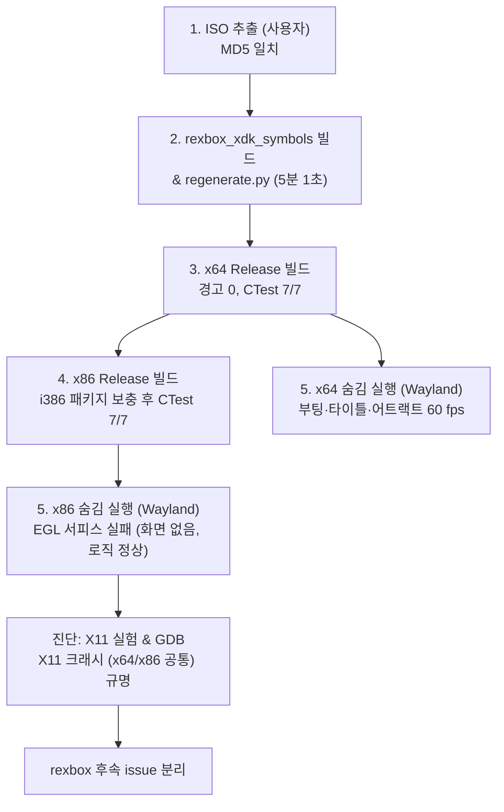

# 작업 로그: Linux 실기에서 재컴파일 코드 생성, x64·x86 빌드, 게임 실행 (issue #16)

설계: [`docs/design/20261110-i016-linux-build.md`](../design/20261110-i016-linux-build.md) · 작업 지시: [`docs/work-orders/20261110-i016-linux-build.md`](../work-orders/20261110-i016-linux-build.md)

* 환경: Linux 실기 (Ubuntu 26.04.1 LTS, GCC 15.2.0, CMake 4.2.3, NVIDIA GeForce RTX 4090 / 드라이버 595.99.02, Wayland 세션)
* 역할 분담: Claude 총괄·설계·리뷰, Antigravity 구현(명령 실행 및 문서화)



## 1. 단계별 결과

| 단계 | 작업 | 소요 시간 | 결과 및 주요 수치 |
|---|---|---|---|
| 1. 게임 파일 | extract-xiso로 ISO 추출 (사용자) | - | `roms/DEFAULT.XBE` MD5 `575f861eb700e86a82c0ad530dc4a310` 확인 |
| 2. 생성 | `rexbox_xdk_symbols` 빌드 및 `regenerate.py` | 5분 1초 (`real 5m1.308s`) | 5,547 함수, 실패 0, 23개 파일, C 1,063,825줄 (41 MB). Win32 i004와 수치 일치 |
| 3. x64 빌드 | `scripts/build_linux.sh x64 release` | 1분 26초 (`real 1m26.854s`) | 컴파일러 경고 0건, CTest 7/7 전체 통과 |
| 4. x86 빌드 | `scripts/build_linux.sh x86 release` | 2분 31초 (`real 2m31.891s`) | 1차 configure 중 `libxss-dev:i386`·`libxtst-dev:i386` 누락으로 중단 → 사용자 패키지 설치 후 재실행하여 경고 0건, CTest 7/7 전체 통과 |
| 5. x64 실행 | Wayland 숨김 실행 (`timeout 130`) | 100초 (watchdog) | 종료 코드 `exit=4` (`[watchdog] still running after 100 s`), 크래시/stall 없음, 부팅 로고(`ESRB.DAT`)→인트로(`INTRO.DAT`)→타이틀(`TITLE.WMA`)→어트랙트 데모(`STAT.DAT`, `HS.WMA`, draws 82)까지 60.0 fps 완주 |
| 5. x86 실행 | Wayland 숨김 실행 (`timeout 130`) | 100초 (watchdog) | 종료 코드 `exit=4`, `unable to create an EGL window surface`로 화면 미표시(draws 0), 게임 로직은 어트랙트 데모(`AE01.DAT`)까지 60.0 fps 진행 |

## 2. 진단 과정 (x86 화면 미표시 및 X11 크래시)

x86 숨김 실행에서 게임 로직은 정상 구동되나 화면 드로우가 0인 현상을 규명하기 위해 실험을 수행했다.

1. **EGL 디버그 실험 (B)**:
   * `SDL_VIDEO_DRIVER=wayland EGL_LOG_LEVEL=debug`로 실행.
   * `SDL_CreateWindow` 단계에서 `unable to create an EGL window surface (call to eglCreateWindowSurface failed, reporting an error of EGL_SUCCESS)` 오류 반환.
   * 32비트 NVIDIA 드라이버 라이브러리(`libnvidia-gl-595:i386`)가 정상 설치되어 있음에도 Wayland 창 서피스 생성이 실패함.
   * 또한 이 x86 프로세스는 SIGTERM에 반응하지 않아 SIGKILL로 정리되었다.
2. **X11 드라이버 강제 실험 (A)**:
   * `SDL_VIDEO_DRIVER=x11`로 실행 시 OpenGL 3.3 디스플레이(`RTX 4090`)가 정상 오픈되었으나, 첫 그림 직후 스레드 3에서 fault 발생으로 비정상 종료:
     `thread 3 (start 000844CD): fault 0000000B, read at guest EF000520, outside guest RAM (host 0x520, instruction 0xe3437a06)`
3. **x64 X11 비교 실험 (C)**:
   * x64 바이너리를 `SDL_VIDEO_DRIVER=x11`로 실행했을 때도 동일하게 첫 프레임 직후 스레드 3 fault 발생 (`host 0xa40, instruction 0x7bc5ce991a09`, `last indirect call FE000498`).
   * 이로써 문제가 x86 32비트 고유 문제가 아니라 **X11 실행 경로 공통 결함**임이 확정되었다.
4. **GDB 백트레이스 분석 (x86 RelWithDebInfo)**:
   * `libGLdispatch.so.0`의 `jmp *0x520(%eax)`에서 `eax=4`(유효하지 않은 디스패치 테이블)로 SIGSEGV 발생.
   * 콜스택:
     ```text
     #0  0xedd21a06 in ?? () from /usr/lib/i386-linux-gnu/libGLdispatch.so.0
     #1  BuildKey (...) at third_party/rexbox/src/hle/d3d8/d3d8_draw.cpp:245
     #2  Draw ("DrawVerticesUP") at third_party/rexbox/src/hle/d3d8/d3d8_draw.cpp:958
     #3  D3DDevice_DrawVerticesUP () at third_party/rexbox/src/hle/d3d8/d3d8_draw.cpp:1274
     #4  RunSlotExport (slot_00177BB0) at third_party/rexbox/src/recomp/recomp_bridge.cpp:67
     ...
     #16 sub_000844CD () at gen/exceed_us/gen/recomp_0003.c:19226
     ```
   * 게스트 스레드 3번이 `DrawVerticesUP`를 호출했으나, 해당 호스트 스레드에는 OpenGL 컨텍스트가 바인딩되어 있지 않아 libGLdispatch의 디스패치 테이블이 유효하지 않았다. rexbox가 보고한 게스트 주소 `EF000520`은 호스트 주소 `0x520`을 게스트 주소로 환산한 값이다.
5. **Wayland vs X11 HLE 추적 로그 비교**:
   * 정규화된 4109번째 줄에서 갈라짐:
     * `[d3d8] texture format 0F dim 2 levels 7 cube 0 swizzled, type 4 (header 040F2260)` 직후,
     * **Wayland**: `texture upload: format 0F 64x64, 7 level(s)` 및 추가 텍스처/변환 설정을 거쳐 드로우 루프로 정상 진입.
     * **X11**: 즉시 `thread 1 (start 0008673A): returned, eax 00000001`이 발생하여 게임 메인 루프가 종료되고, 뒤이어 스레드 3이 드로우를 시도하다 GL fault로 크래시.
   * `REXBOX_HLE_TRACE=4000` 한도에 도달하여 메인 스레드가 반환하기 직전의 호출 내역은 로그에 남지 않았다.

## 3. 검토 후 배제된 가설

1. **i386 구조체 정렬(ABI) 불일치 가설**:
   * 가설: 32비트 호스트에서 HLE 내부 구조체 패킹이나 정렬 차이로 인해 스레드 3이 깨진 메모리를 읽었을 것이다.
   * 배제 근거: 64비트 바이너리(x64 Release)에서도 `SDL_VIDEO_DRIVER=x11`을 주었을 때 완전히 동일한 지점(스레드 1 반환 후 스레드 3 fault)에서 크래시가 재현되었다. 아키텍처나 구조체 정렬 문제가 아닌 윈도잉/이벤트 처리 경로의 문제이다.
2. **모니터 리프레시 레이트(59.99 Hz vs 60.00 Hz) 타이밍 가설**:
   * 가설: Wayland(60.00 Hz)와 X11(59.99 Hz)의 보고된 모니터 갱신 주기 차이가 vsync 타이밍 불일치를 일으켜 메인 루프를 종료시켰을 것이다.
   * 배제 근거: 게스트가 보는 주사율은 게스트가 `D3DPRESENT_PARAMETERS`에 준 값(`pp.refresh_rate`, `d3d8_query.cpp`)이며 호스트 모니터 값(`DisplayInfo::refresh_hz`)은 게스트에 전달되지 않는다. 호스트 값은 vsync 판단에만 쓰인다.

## 4. 마무리

* **창 실행(작업 지시서 6단계)**: 사용자가 x64를 Wayland 데스크톱에서 실행해 정상 동작을 확인했다.
* **범위 결정(사용자)**: #16은 x64로 마무리하고, 아래 두 문제는 rexbox issue로 분리했다.
  1. [rexbox #85](https://github.com/reexec/rexbox/issues/85): X11(GLX)에서 첫 그림 직후 게임 메인 스레드가 반환하고, GL 컨텍스트가 없는 게스트 스레드의 D3D8 호출이 드라이버 안에서 fault한다.
  2. [rexbox #86](https://github.com/reexec/rexbox/issues/86): x86의 NVIDIA Wayland에서 EGL 창 서피스 생성 실패, 그 실행의 SIGTERM 무반응.
* `scripts/build_linux.sh`를 git에서 100755로 바꿨다. 가이드 8절(알려진 제한)과 README 플랫폼 표를 갱신했다.

---

# Work Log: Recompiled Code Generation, x64 and x86 Builds and Game Execution on a Linux Machine (issue #16)

Design: [`docs/design/20261110-i016-linux-build.md`](../design/20261110-i016-linux-build.md) · Work order: [`docs/work-orders/20261110-i016-linux-build.md`](../work-orders/20261110-i016-linux-build.md)

* Environment: Linux physical machine (Ubuntu 26.04.1 LTS, GCC 15.2.0, CMake 4.2.3, NVIDIA GeForce RTX 4090 / driver 595.99.02, Wayland session)
* Roles: Claude led, designed and reviewed; Antigravity implemented (command execution and documentation).

## 1. Step-by-step Results

| Step | Task | Duration | Result & Key Metrics |
|---|---|---|---|
| 1. Game files | ISO extraction via extract-xiso (User) | - | Verified `roms/DEFAULT.XBE` MD5 `575f861eb700e86a82c0ad530dc4a310` |
| 2. Generation | Build `rexbox_xdk_symbols` & run `regenerate.py` | 5m 1s (`real 5m1.308s`) | 5,547 functions, 0 failures, 23 files, 1,063,825 lines of C (41 MB). Matches Win32 i004 metrics |
| 3. x64 build | `scripts/build_linux.sh x64 release` | 1m 26s (`real 1m26.854s`) | 0 compiler warnings, CTest 7/7 all passed |
| 4. x86 build | `scripts/build_linux.sh x86 release` | 2m 31s (`real 2m31.891s`) | 1st configure halted due to missing `libxss-dev:i386` and `libxtst-dev:i386` -> resumed after user installed packages; 0 compiler warnings, CTest 7/7 all passed |
| 5. x64 run | Wayland hidden run (`timeout 130`) | 100s (watchdog) | Exit code `exit=4` (`[watchdog] still running after 100 s`), no crash/stall, ran through boot logo (`ESRB.DAT`) -> intro (`INTRO.DAT`) -> title (`TITLE.WMA`) -> attract demo (`STAT.DAT`, `HS.WMA`, draws 82) at 60.0 fps |
| 5. x86 run | Wayland hidden run (`timeout 130`) | 100s (watchdog) | Exit code `exit=4`, no visible picture (draws 0) due to `unable to create an EGL window surface`, game logic ran cleanly through attract demo (`AE01.DAT`) at 60.0 fps |

## 2. Diagnostics (x86 Display Absence and X11 Crash)

Investigated the condition where x86 game logic runs normally while frame draws remain 0.

1. **EGL Debug Experiment (B)**:
   * Executed with `SDL_VIDEO_DRIVER=wayland EGL_LOG_LEVEL=debug`.
   * `SDL_CreateWindow` failed with `unable to create an EGL window surface (call to eglCreateWindowSurface failed, reporting an error of EGL_SUCCESS)`.
   * Occurs despite proper installation of 32-bit NVIDIA driver libraries (`libnvidia-gl-595:i386`).
   * The process ignored SIGTERM and required SIGKILL.
2. **X11 Driver Override Experiment (A)**:
   * Running with `SDL_VIDEO_DRIVER=x11` successfully opened the OpenGL 3.3 display (`RTX 4090`), but crashed right after the first picture with a thread 3 fault:
     `thread 3 (start 000844CD): fault 0000000B, read at guest EF000520, outside guest RAM (host 0x520, instruction 0xe3437a06)`
3. **x64 X11 Comparison Experiment (C)**:
   * Running the x64 binary with `SDL_VIDEO_DRIVER=x11` reproduced the exact same thread 3 fault right after the first frame (`host 0xa40, instruction 0x7bc5ce991a09`, `last indirect call FE000498`).
   * Confirmed this is not an x86 32-bit issue, but an **X11 execution path defect**.
4. **GDB Backtrace Analysis (x86 RelWithDebInfo)**:
   * SIGSEGV in `libGLdispatch.so.0` at `jmp *0x520(%eax)` with `eax=4` (an invalid dispatch table).
   * Callstack showed guest thread 3 called `DrawVerticesUP`, but that host thread had no bound OpenGL context; the guest address `EF000520` in rexbox's report is the host address `0x520` read as a guest one.
5. **Wayland vs X11 HLE Trace Comparison**:
   * Diverged at normalized line 4109:
     * Immediately following `[d3d8] texture format 0F dim 2 levels 7 cube 0 swizzled, type 4 (header 040F2260)`,
     * **Wayland**: proceeded with `texture upload: format 0F 64x64, 7 level(s)` and entered the draw loop normally.
     * **X11**: `thread 1 (start 0008673A): returned, eax 00000001` occurred immediately, ending the game main loop, after which thread 3 attempted a draw and crashed inside libGLdispatch.
   * Reached `REXBOX_HLE_TRACE=4000` limit, so calls right before the return were unrecorded.

## 3. Rejected Hypotheses

1. **i386 Structure Alignment / Packing Hypothesis**:
   * Hypothesis: 32-bit host packing differences led thread 3 to read corrupt memory.
   * Rejection: Perfectly reproduced on 64-bit builds (x64 Release) under `SDL_VIDEO_DRIVER=x11`. Not an architecture or alignment bug.
2. **Monitor Refresh Rate (59.99 Hz vs 60.00 Hz) Timing Hypothesis**:
   * Hypothesis: Small discrepancy in reported refresh rates threw off frame timing.
   * Rejection: the guest sees the rate it gave in `D3DPRESENT_PARAMETERS` (`pp.refresh_rate`, `d3d8_query.cpp`); the host monitor's rate (`DisplayInfo::refresh_hz`) never reaches the guest and is only used for the vsync decision.

## 4. Wrap-up

* **Windowed run (work order step 6)**: the user ran x64 on the Wayland desktop and confirmed it works.
* **Scope (the user's decision)**: #16 closes with x64; the two problems below go to rexbox issues.
  1. [rexbox #85](https://github.com/reexec/rexbox/issues/85): on X11 (GLX) the title's main thread returns right after the first picture, and a guest thread with no GL context then faults inside the driver on a D3D8 call.
  2. [rexbox #86](https://github.com/reexec/rexbox/issues/86): on NVIDIA Wayland the x86 build cannot create the EGL window surface, and that run ignores SIGTERM.
* `scripts/build_linux.sh` is now 100755 in git; the guide's section 8 (known limitations) and the README platform table are updated.
